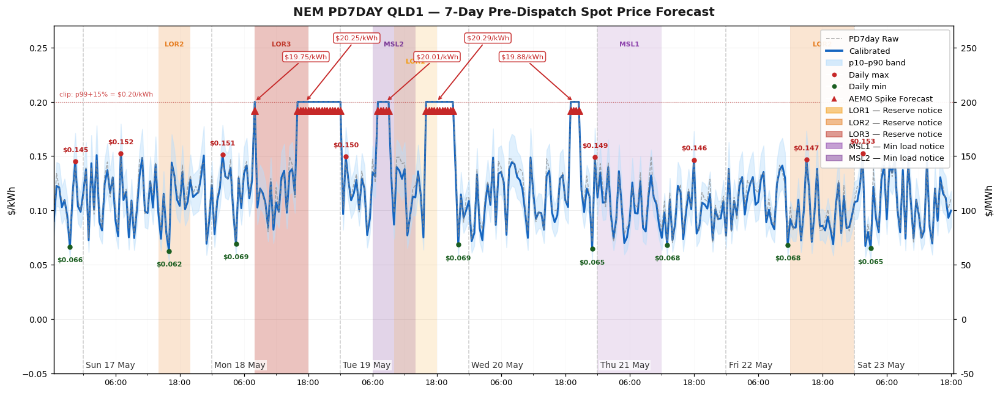

# NEM PD7DAY Price Forecast — Home Assistant Integration

[](https://github.com/hacs/integration)
[](https://www.home-assistant.io/)
[](https://github.com/purcell-lab/nem_pd7day/releases)

A Home Assistant custom integration that provides **days 2–7 electricity price and tariff forecasts** from AEMO's PD7DAY pre-dispatch data for the National Electricity Market (NEM). Designed to complement Amber Electric's 24-hour Express forecast, this integration covers the window beyond Amber's reach.

AEMO publishes PD7DAY three times per day (07:30, 13:00, 18:00 AEST). This integration fetches those updates on the same schedule and applies a two-stage on-device calibration pipeline — isotonic regression for bias correction, followed by an OLS correction using AEMO STPASA supply/demand features — to produce calibrated estimates with P10/P50/P90 confidence bands.

---

## How it works — Two-stage forecasting pipeline

The integration uses a two-stage forecasting pipeline:

- **Stage 1 — PD7DAY isotonic calibration**: AEMO's 7-day PD7DAY price forecasts are calibrated using isotonic regression fit on 60 days of rolling history. This corrects systematic bias and shapes the time-of-day profile across all horizons (h0–168). Each step of the map is levelled at the weighted median of its rows, and a step whose rows span fewer than 10 distinct days is pulled toward the bucket's P50 line in proportion, so one day's spike or one high midday cannot set the price for every forecast in its range.
- **Stage 2 — STPASA OLS correction** (horizons h22–h120): At medium-range horizons, an OLS model trained on AEMO STPASA supply/demand features (solar UIGF, wind UIGF, surplus capacity, demand 10/50/90) further corrects the isotonic output. Beyond h120, the model falls back to isotonic-only. Stage 2 is only served where its extrapolation stays within the uncertainty the bucket already publishes: each feature's distance outside the training range recorded with the bucket's coefficients is weighed by the coefficient it multiplies, and if the sum exceeds half the bucket's residual spread (for example `log_demand` on a day STPASA forecasts a few tens of MW of scheduled demand) the isotonic result is published instead. A hairline excursion on a feature the model barely uses costs nothing and is served. Intervals whose STPASA demand50 is below 1 MW carry no STPASA features at all.

### Performance vs isotonic-only

- MAE improvement at h24–168: **−10.7%** vs isotonic alone (14.65 vs 16.06 $/MWh)
- Day-rank Spearman ρ: **0.917** vs 0.850
- Solar UIGF is the dominant STPASA signal (ρ = −0.78)

---

## Use Cases

- **Battery dispatch optimisation** — use the 7-day calibrated forecast and P10/P90 bands to schedule battery charge/discharge cycles beyond the Amber 24-hour window, minimising import cost and maximising export revenue at peak periods.
- **EV charging scheduling** — identify the cheapest 2-hour window over the next 7 days (`cheapest_2h_window` attribute) and trigger overnight EV charging at the lowest forecast price.
- **Hot water pre-heating** — use the `min_24h_value` attribute to trigger resistive hot water heating during forecast low-price windows (solar sponge periods).
- **Grid stress awareness** — the `grid_stress` binary sensor and grid notices count sensor provide advance warning of LOR/MSL events, allowing pre-emptive load shifting.
- **Linear programming dispatch** — feed the full `forecast` attribute list into an LP optimiser (e.g. EMHASS) as the price signal for multi-day horizon planning.
- **Tariff arbitrage** — use the network-aware tariff sensors (Energex, Ausgrid, etc.) for accurate import/export tariff forecasting that accounts for time-of-use network charges.

---

## Features

- **Days 2–7 price forecast** — calibrated $/kWh with P10/P50/P90 confidence bands, trimmed to the window beyond Amber Express
- **Isotonic calibration** — monotone PAV regression bias correction fitted on actual TradingIS vs PD7DAY pairs, with per-bucket compression ratio, iso_mae, and P10/P90 confidence intervals
  - Each bucket is a horizon band and a time of day classified from the interval's solar elevation in its region: `peak` 16:00 to 21:00 NEM time, `solar` with the sun above 25 degrees (15 before v3.30.0, [#267](https://github.com/purcell-lab/nem_pd7day/issues/267)), `morning_ramp` from 0 to 25 degrees (early morning, and a low winter sun before 16:00), `shoulder` otherwise. Stage 2 and the published values use the same bucket the interval was trained in; before v3.21.0 they looked it up by clock hour ([#208](https://github.com/purcell-lab/nem_pd7day/issues/208)).
- **Interconnector flows** — interconnector MW flow forecasts for the configured region
- **Market intervention flag** — binary sensor from CASESOLUTION data
- **Calibration diagnostic** — observation count, active bucket count, fit quality per bucket
- **Live charts** — two camera entities updated after each refit:
  - **Price ToD Chart** — actual price by time of day (mean, median, P10–P90 spread across all observed intervals)
  - **Calibration Chart** — isotonic calibration goodness dashboard: compression ratio heatmap, iso_mae bars, PAV complexity scatter, and compression ratio drift time-series
- **Cloud polling** — two independent polling loops:
  - **PD7DAY** fetches at AEMO publish times: 07:30, 13:00, 18:00 AEST (3 requests/day)
  - **TradingIS** fetches actual 5-min dispatch prices every 30 minutes (48 requests/day)
- **5-minute dispatch prices** — boundary-aligned `DispatchCoordinator` polls NEMWEB TradingIS at `:01:15`, `:06:15`, ..., `:56:15` (75 s after each dispatch boundary, after NEMWEB publishes). Used as the live `native_value` for tariff and spot sensors between 30-minute PD7DAY intervals.
- **Live sensor state** — all forecast sensor states advance automatically every 30 minutes to reflect the current interval, with no fetch required
- **No third-party accounts required** — actual prices sourced directly from AEMO TradingIS
- **Dependencies** — `numpy` (installed by HA from the manifest); `matplotlib` for the chart cameras, an optional requirement the cameras ask HA's installer for at run time, so an install where it cannot be built still loads every sensor; `astral` for solar elevation, which ships with Home Assistant itself and so is not listed in the manifest

---

## Requirements

- Home Assistant 2024.1 or later
- Network access to `www.nemweb.com.au`
- `aemo-to-tariff`, installed by Home Assistant at the exact version in `manifest.json`. The tariff sensors' GST handling restates how that version treats each network, and the library is moving networks to GST inclusive rates, so the pin moves only when the tests have passed against the new version (#167). A scheduled CI job runs the library probes against the newest release daily and opens an issue if they fail.

---

## Installation

### Via HACS (recommended)

1. Open HACS in your HA instance
2. Go to **Integrations → Custom repositories**
3. Add `https://github.com/purcell-lab/nem_pd7day` with category **Integration**
4. Search for **NEM PD7DAY** and install
5. Restart Home Assistant
6. Go to **Settings → Devices & Services → Add Integration** and search for **NEM PD7DAY**

### Manual

1. Download the latest release zip from the [Releases page](https://github.com/purcell-lab/nem_pd7day/releases)
2. Extract `custom_components/nem_pd7day/` into your HA config directory
3. Restart Home Assistant
4. Go to **Settings → Devices & Services → Add Integration** and search for **NEM PD7DAY**

---

## Removal

1. Go to **Settings → Devices & Services**
2. Find **NEM PD7DAY** and click **⋮ → Delete**
3. Confirm deletion

This removes the integration and all its entities. Calibration storage files are not automatically deleted. To fully clean up, remove the following files from your HA config `.storage/` directory:

```bash
rm /config/.storage/nem_pd7day.{region}.observation_segments
rm /config/.storage/nem_pd7day.{region}.observations.*
rm /config/.storage/nem_pd7day.{region}.observation_log   # only on installs upgraded from before v3.9.0
rm /config/.storage/nem_pd7day.{region}.calibration_coefficients
rm /config/.storage/nem_pd7day.{region}.forecast_history
rm /config/.storage/nem_pd7day.{region}.stpasa
```

Replace `{region}` with the lowercase region code (e.g. `qld1`, `nsw1`).

---

## Configuration

The integration is configured via a single-step UI flow.

| Field | Default | Description |
|---|---|---|
| NEM Region | QLD1 | The NEM region to monitor: `QLD1`, `NSW1`, `VIC1`, `SA1`, or `TAS1` |

The configured region is used for both price forecasting and calibration. No additional settings are required.

Options (Settings → Devices & services → NEM PD7DAY → Configure) also hold:

| Option | Default | Description |
|---|---|---|
| Active tariff | Automatic | The tariff the day 2-7 tariff sensors follow. Automatic takes the tariff your Amber site reports (an Amber Express site sensor's `network` and the `tariff` of its `general` channel), and otherwise the region's first default-enabled tariff. |
| Enable only the active tariff's sensors | On | Disables the region's other tariff sensors, leaving the active tariff and its export partner. It applies only when the tariff is chosen here or reported by Amber, never on the default guess; a sensor you enable yourself is left on, and turning the option off re-enables what it disabled. |
| Amber forecast override | empty | See *Joining the day 2-7 series to an Amber forecast*. |

The Day 2-7 sensors of a tariff that is no longer active are removed from the entity registry when the integration loads ([#260](https://github.com/purcell-lab/nem_pd7day/issues/260)).

No `configuration.yaml` entries are required.

### Joining the day 2-7 series to an Amber forecast

No setting is needed. If Amber Electric or Amber Express is installed, the day 2-7 sensors find its forecast sensors and start exactly where Amber's forecast ends, read from its last interval's end time, so a sum of the two (for example HAEO's grid price inputs) has no gap and no overlap. They follow Amber as it extends its forecast, re-writing when the end moves rather than on every Amber update. With both installed and in agreement, which is usual, they share one end; should they ever disagree, the earlier end is used, since an interval priced twice is a safer error than one priced at 0.

With no Amber integration, or while its sensors are unavailable or their forecast has ended, the day 2-7 series starts by the clock: after tomorrow 03:30 between 03:30 and 12:30 NEM, otherwise after now + 24 h. Amber's real coverage does not follow that clock, so before #235 a sum had a hole: 30 minutes on most refreshes, and up to about 9 hours just after 12:30. An Amber integration added later is found at the next reload of this integration.

To join one particular Amber forecast instead, for example with two Amber sites installed, choose it under **Amber forecast override** in the integration's options (**Settings → Devices & services → NEM PD7DAY → Configure**). Only Amber's own sensors are searched or offered: a template that wraps an Amber forecast usually carries a closing point rather than an interval start.

The day 2-7 sensors report `forecast_start` (the first interval listed) and `forecast_start_source` (`amber` or `clock`).

They also publish `interpolation_mode: previous`: each value is the price of the 30-minute interval starting at its `time`, held until the next point. When the series starts at Amber's end, the first point is published one second after that end (for example `20:30:01` for the interval starting 20:30); `forecast_start` keeps the interval's own start. HAEO 0.5 holds Amber's last price up to and including its end and sums its price inputs on their joined timestamps, so a first point at the same instant was added to Amber's last price and the interpolation spread the doubled price over the hour around the seam (on 25 Oct 2026, about 29 c/kWh instead of 19 c from 20:00 to 21:00). One second later the two never share a point; HAEO 0.4 reads the series as before (#270).

### Loss factor (optional)

Every tariff price scales spot by a loss factor before adding the network rate. By default it is the tariff library's Energex defaults, DLF 1.05905 × MLF 1.0154 × market 1.0154 = **1.0919**, for every distributor.

| Field | Default | Description |
|---|---|---|
| Loss factor (spot multiplier) | empty | One combined factor used for every import and export tariff price in place of the defaults, from 0.9 to 1.3. Empty uses the defaults |

Retailers apply the site's own factor. On an Amber Energex site, settled prices follow RRP × **1.0272** exactly: feed-in = RRP × 1.0272 (less the 2.21 c charge from 11:00 to 13:00, April to October), and import = (RRP × 1.0272 + network rate + Amber's fee) × 1.1. That held in all 576 intervals checked against NEMWEB, so the default overstated the spot part of both prices by about 6.3%.

The options form shows the factor in Amber Express's current settled feed-in interval: its `per_kwh` × 1.1 / `spot_per_kwh`, since `spot_per_kwh` carries GST. It is only a suggestion and is never applied by itself; inside an export charge or credit window it is not the loss factor. The tariff sensors publish what they use as `combined_loss_multiplier`, and `loss_factor_source` (`option` or `library_default`).

### DUID local price adjustments (optional)

| Field | Default | Description |
|---|---|---|
| DUID local price adjustments | empty | A dropdown of the region's DUIDs, most constrained first, labelled with the station and fuel (`GSTONE1 · Gladstone (coal black)`). A DUID not in the list, such as one registered since the catalogue was built, can be typed; it must be up to ten letters or digits, and may contain `_`, `-`, `#` or `/`. Each chosen DUID gets one sensor, enabled |

A DUID is a generating or load unit, not your connection point. Its local price adjustment is a geographic signal of network congestion near that unit, nothing more: it is not added to any existing price, tariff or forecast.

**The region's five most constrained DUIDs are always added, disabled**: enable one from the device page and it starts updating. They are the region's DUIDs with the largest sum of |adjustment| over the catalogue's two-week window. P5MIN is fetched only while at least one DUID sensor is enabled, so the disabled presets cost nothing. Choosing a preset in the options enables the sensor the integration disabled; a sensor you disabled stays disabled.

**The DUID catalogue** (`duid_catalogue.json`) is bundled with the integration and rebuilt before each release by `scripts/build_duid_catalogue.py`. Nothing is fetched at run time. Its sources:

- **AEMO MMSDM DUDETAILSUMMARY and STATION:** each DUID's region, station and dispatch type.
- **Open Electricity's public facility files:** fuel and coordinates. Its live API needs a key, so those files are used instead; a DUID they do not list has no coordinates rather than guessed ones.
- **AEMO DispatchIS LOCAL_PRICE rows:** the ranking.

A catalogued DUID's sensor publishes `station`, `fuel`, `duid_region`, `tni`, `mlf`, `latitude` and `longitude`, so it shows on a map card. The local price uses the ROP of the DUID's own region, and of the entry's region for a DUID the catalogue lacks.

**Non-physical units are not offered** (#311): registrations with no plant behind them, so no location and no meaningful local price adjustment. These are each region's dummy generator (`DG_*`) and reserve trader (`RT_*`), and the VPP, demand response and ancillary service aggregations (`VS*`, `DR*`, `AS*`), 95 in the catalogue. The rule is no coordinates plus a dummy, reserve trader or aggregation marker in the DUID, fuel or station name, so a real plant without coordinates yet (Aldoga Solar Farm) is still offered. A node whose units are all non-physical is not offered either. One already chosen keeps its sensor, is listed in the options marked `non-physical`, publishes `non_physical: true`, and a notice is logged once at setup. It can still be typed.

### Transmission node prices (optional)

| Field | Default | Description |
|---|---|---|
| Transmission node prices | empty | A dropdown of the region's connection points (TNIs), labelled with their stations and DUIDs (`QWIV1 · Wivenhoe (W/HOE#1)`). A TNI not in the list can be typed: two to ten letters or digits. Each chosen node gets one sensor, enabled |

A TNI is a transmission connection point. Its **node price** is the region's original price (ROP) plus the node's local price adjustment, times the node's marginal loss factor (MLF): (ROP + adjustment) × MLF. The **static price**, ROP × MLF, is what a generator connected there is paid per MWh sent out; the adjustment is what binding network constraints near it are worth at the margin, 0 most of the time. Nodes upstream of losses have an MLF below 1, so their static price is below the regional price. The catalogue takes each DUID's TNI and MLF from AEMO's DUDETAILSUMMARY, and groups the DUIDs by TNI. There are no presets. A diagnostic, not a retail or settlement price, and not the price at your own meter: a household is settled at the regional price times its distribution and transmission losses (see the loss factor above).

**Local price and node price** (#312, #313):

| | Formula | Where | Sensor |
|---|---|---|---|
| Local price | ROP + adjustment | At the regional reference node, AEMO's own definition | DUID sensor: `local_price`, `local_price_formula` |
| Node price | (ROP + adjustment) × MLF | At the connection point | Node sensor state, and the DUID sensor's `node_price`; `formula` / `node_price_formula` |

The MLF scales the adjustment too: NEMDE refers every offer to the regional reference node by dividing it by the unit's MLF, so AEMO's adjustment is on that basis, as the ROP is. Of 34 dispatched, locally constrained unit intervals on 31 Oct 2026 (to 19:10, against the bids in force), 17 priced to the cent at one of the unit's own offer bands with (ROP + adjustment) × MLF, and none with ROP × MLF + adjustment (METZSF1, MLF 0.8657: its −114.72 band, against −141.4). Until v3.38.0 the node price was ROP × MLF + adjustment.


### City and zone price proxies (optional)

| Field | Default | Description |
|---|---|---|
| City and zone price proxies | empty | The region's preset cities (QLD1: Brisbane, Gold Coast, Sunshine Coast, Toowoomba, Rockhampton, Mackay, Townsville, Cairns; NSW1: Sydney, Newcastle, Wollongong, Canberra, Wagga Wagga, Tamworth, Orange; VIC1: Melbourne, Geelong, Ballarat, Bendigo, Latrobe Valley; SA1: Adelaide, Port Augusta, Mount Gambier; TAS1: Hobart, Launceston, Burnie) and Home, Home Assistant's own location. Each gets one sensor, enabled |
| Zone radius | 100 km | How far from the centre a catalogue node counts as nearby |
| Home load connection point | empty | The bulk supply point serving your area, from a dropdown of the region's load connection points as AEMO's MLF report names them (`Belmont 110 kV (QBMH) · MLF 1.0128`). Its MLF is the Home zone's |

A zone's price is a **proxy**: (ROP + the median local price adjustment of the region's catalogue nodes within the radius) × zone MLF, the nearest node alone standing in where none is that close.

- **Zone MLF**: the mean MLF of the place's own load connection points. Each preset city lists the bulk supply points that serve it (Brisbane 15, from Algester to Tennyson: 1.0120; Sydney 48: 1.0035; Melbourne 43: 1.0004; Adelaide 13: 1.0012; Hobart 11: 1.0373; Townsville 5: 0.9998), and Home the one chosen above. They come from `load_points.json`, the load tables of AEMO's *Marginal Loss Factors: Financial Year 2026-27* report (513 load points), built by `scripts/build_load_points.py` from the report's PDF, which aemo.com.au does not serve to scripts; every MLF matches MMSDM's TRANSMISSIONLOSSFACTOR. Where no load point is known, the inverse-distance-weighted mean of the nearby nodes' MLFs stands in (`zone_mlf_source: nearby_generation_idw`).
- **Adjustment**: city load is not a variable in NEMDE's constraint equations, so it has no local price adjustment of its own; the nearby generation and storage nodes' adjustments stand in. The median means one constrained unit does not move the zone, while most of them do.

Not a settlement or retail price, and not the price at your meter.

### Monitoring multiple regions

Each integration instance monitors one NEM region with full independent calibration. To monitor multiple regions, add a separate integration instance for each via **Settings → Integrations → Add Integration → NEM PD7DAY**. Each instance maintains its own calibration store, observation log, and forecast sensors.

### Recorder warnings (expected, harmless)

The forecast and tariff sensors carry large attribute payloads (7 days × 48 intervals each). Home Assistant will log warnings like:

```
State attributes for sensor.nem_pd7day_*_tariff exceed maximum size of 16384 bytes.
Attributes will not be stored
```

These warnings are **expected and harmless**. The sensor `state` value (the current $/kWh price) is always recorded and available in history — only the large `forecast` attribute list is dropped by the recorder. No configuration changes are needed.

> **Do not add `recorder: exclude: entity_globs`** for nem_pd7day sensors — doing so prevents the sensor state from being recorded, which breaks the history graph in the HA UI.

---

## Data sources and polling

The integration runs two independent polling loops.

### PD7DAY forecasts (3×/day)

AEMO publishes 7-day ahead price forecasts three times per day. The integration fetches on the same schedule using `async_track_point_in_utc_time`:

| NEM time (AEST) | UTC |
|---|---|
| 07:30 | 21:30 (previous day) |
| 13:00 | 03:00 |
| 18:00 | 08:00 |

Source: [AEMO NEMWeb PD7DAY](https://www.nemweb.com.au/REPORTS/CURRENT/PD7Day/)

### STPASA supply/demand outlook

The Stage 2 OLS correction is driven by AEMO's STPASA (Short-Term Projected Assessment of System Adequacy) feed, which provides the supply/demand outlook across all NEM regions in a single ZIP: solar UIGF, wind UIGF, surplus capacity, and demand 10/50/90 percentiles.

Source: [AEMO NEMWeb STPASA](https://www.nemweb.com.au/REPORTS/CURRENT/Short_Term_PASA_Reports/)

### TradingIS actual prices (every 30 minutes)

Actual NEM dispatch prices are fetched from AEMO's TradingIS reports and used to build calibration observations:

- **URL**: `https://www.nemweb.com.au/REPORTS/CURRENT/TradingIS_Reports/`
- **Schedule**: at HH:02 and HH:32 NEM time — 2 minutes after each 30-minute trading interval closes
- **Method**: downloads the 6 × 5-minute dispatch files for the closed interval, averages the RRP values ($/MWh → $/kWh)
- **Observation tagging**: each calibration observation records `actual_source: "tradingis"`

### Live dispatch prices (every 5 minutes, boundary-aligned)

5-minute dispatch prices for the sensor `native_value` are fetched from AEMO TradingIS on a boundary-aligned schedule:

- **URL**: `https://www.nemweb.com.au/Reports/Current/TradingIS_Reports/`
- **Schedule**: 75 seconds after each 5-minute UTC boundary (`:01:15`, `:06:15`, ..., `:56:15`). AEMO typically publishes 65–90 s after the interval boundary; 75 s sits within that window with margin (`_DISPATCH_POLL_DELAY_S = 75`).
- **Alignment**: uses `async_track_point_in_utc_time` with self-rescheduling one-shot callbacks — no drift from HA startup time.

### Binding constraints (every 5 minutes, after the dispatch poll)

The network constraints binding in each dispatch interval come from AEMO's DispatchIS reports, one file for all regions:

- **URL**: `https://www.nemweb.com.au/Reports/Current/DispatchIS_Reports/`
- **Schedule**: no timer of its own. One shared fetch runs each time the live dispatch poll completes, and a failure here never delays or affects the price.
- **Load**: two NEMWEB requests per interval through the shared NEMWEB request gate, the directory listing (about 17 KB compressed) and the zip (about 22 KB). That is about 576 requests and 11 MB a day. NEMWEB answers rapid callers with 403, so the requests share the gate and its spacing with every other NEMWEB fetch.

### DUID local prices (every 5 minutes, after the dispatch poll, only while a DUID sensor is enabled)

- **Dispatch**: the `DISPATCH,LOCAL_PRICE` and `DISPATCH,PRICE` rows of the same DispatchIS file the binding constraints read. No extra request.
- **Forecast**: the newest P5MIN run, `https://www.nemweb.com.au/Reports/Current/P5_Reports/`, its `LOCAL_PRICE` and `REGIONSOLUTION` tables: twelve five-minute intervals. One shared coordinator serves every entry, DUID and transmission node; the node price sensors use the same data. After each dispatch poll it reads the listing (about 16 KB compressed) once the run it holds has reached its first interval's end, and the zip (about 210 KB, about 60 MB a day) only when a newer run is listed. The CSV (about 3 MB) is unzipped and parsed in the executor, through the shared NEMWEB request gate. A failure here never touches the price path.

### Pre-dispatch interconnectors and constraints (every 30 minutes, after the dispatch poll)

AEMO's 30-minute pre-dispatch runs every half hour and covers each trading period to the end of the next trading day. One PredispatchIS file carries every region's price, every interconnector's flow and limits, every constraint's marginal value, and each constrained DUID's local price adjustment (`PREDISPATCH,LOCAL_PRICE`, read for the DUID and node sensors' `predispatch_forecast`):

- **URL**: `https://www.nemweb.com.au/Reports/Current/PredispatchIS_Reports/`
- **Schedule**: no timer of its own. After each live dispatch poll the shared coordinator checks whether the run it holds is 30 minutes old; only then does it read the listing, so usually one or two listing requests per half hour, and one zip per new run.
- **Load**: the zip is about 800 KB (about 38 MB a day), the CSV inside about 8 MB; it is unzipped and parsed in the executor, through the shared NEMWEB request gate. A failure here never touches the price path.

### Sensor state updates (every 30 minutes)

Forecast sensor states — price forecast and interconnector flow — advance automatically at each 30-minute interval boundary (:00 and :30 past every hour). The state always reflects the current interval from the most recent fetch, without waiting for the next PD7DAY fetch. This means:

- After the 07:30 fetch, the price forecast sensor state will step through each 30-minute interval for the rest of the day
- After HA restart, the state reflects the current interval immediately on load
- Between fetches, the raw forecast data is unchanged — only the *active interval* advances

---

## Sensors

All sensors are grouped under a single HA device named **NEM PD7DAY {region}** (e.g. `NEM PD7DAY QLD1`).

### Spot Price Days 2-7

`sensor.nem_pd7day_{region}_price_forecast` — the primary calibrated spot price forecast sensor (days 2–7 only, trimmed to exclude the Amber Express window).

| Attribute | Description |
|---|---|
| `state` | Calibrated price for the current interval ($/kWh) |
| `region` | NEM region code |
| `forecast_generated_at` | ISO-8601 timestamp of the AEMO source file |
| `data_age_hours` | Hours since the last successful PD7DAY fetch at the time the entity last wrote state; `null` until the first fetch of the session. Diagnostic sensors rewrite on the half hour so this moves during an outage |
| `last_success_at` | NEM-time ISO-8601 timestamp of the last successful PD7DAY fetch; stays true between state writes, unlike an age |
| `is_stale` | `true` while the last fetch failed and the previous result is being served, or while a publish slot (07:30, 13:00, 18:00 NEM) is more than 30 minutes past and the run being served is older than it |
| `stale_reason` | The failure being served through, e.g. `403 Forbidden`, or `missed 07:30 run` when a slot passed without its file; `null` when fresh |
| `forecast` | List of all forecast periods (see below) |
| `next_value` | Calibrated price for the next interval |
| `min_24h_value` | Minimum calibrated price in the first 24 hours of this sensor's window (the 24 hours after the Amber Express cutoff) |
| `max_24h_value` | Maximum calibrated price in the first 24 hours of this sensor's window |
| `cheapest_2h_window` | Best contiguous 2-hour window over the whole days 2–7 window, by design |
| `forecast_start` | `time` of the first interval listed: where the days 2–7 window begins |
| `forecast_start_source` | `amber` when the window starts where the Amber forecast ends, `clock` when it starts by the clock rule (see *Joining the day 2-7 series to an Amber forecast*) |
| `interpolation_mode` | `previous`: each value holds until the next point. With an `amber` start, the first point's `time` is one second after Amber's end (#270) |

Each entry in `forecast` contains:

```yaml
nemtime: "2026-04-15T17:30:00+10:00"   # interval END (AEMO convention)
time:    "2026-04-15T17:00:00+10:00"   # interval START
raw_value: 0.084                        # raw AEMO forecast ($/kWh)
calibrated: 0.142                       # isotonic-calibrated value; can be negative (NEM prices go below zero, and the model is fitted on those actuals)
p10: 0.091                             # 10th percentile (optimistic); floored at the -1.0 $/kWh market floor, not at zero
p50: 0.138                             # 50th percentile (median)
p90: 0.231                             # 90th percentile (conservative)
ols_mae: 0.038                         # mean absolute error of calibration fit
calibrated_source: isotonic+stpasa     # "isotonic+stpasa" (h22–h120), "isotonic", "isotonic_below_domain" (raw forecast below every forecast the bucket was fitted on, published as the bucket's value at its floor, point and band, since there is no settled actual near the raw value), "passthrough_high", "passthrough_sanity", or "passthrough"
band_source: stage2_residual           # how p10/p90 were derived: "stage1_quantile", "stage1_quantile_unclamped", "raw_passthrough" (no fitted quantile line), "stage2_residual", or "stage1_quantile_reclamped"
n_obs: 147                             # observations used for this bucket
horizon_hours: 36.5                    # hours ahead
value: 0.142                           # alias for calibrated (template compat)
```

> **Timestamp convention**: `nemtime` is the interval END timestamp as published by AEMO. `time` is the interval START (`nemtime − 30 minutes`). This matches the AEMO dispatch interval convention.

---

---

### Interconnector Flow

`sensor.pd7day_{region}_ic_{interconnector}` — one sensor per interconnector touching the configured region.

| Attribute | Description |
|---|---|
| `state` | Current period MW flow (positive = export) |
| `interconnector_id` | Interconnector identifier |
| `forecast` | List of forecast periods with `nemtime`, `time`, `mw` |

Default interconnectors per region:

| Region | Interconnectors |
|---|---|
| QLD1 | NSW1-QLD1, N-Q-MNSP1 |
| NSW1 | NSW1-QLD1, VIC1-NSW1, N-Q-MNSP1, NSW1-SA1 |
| VIC1 | VIC1-NSW1, V-SA, V-S-MNSP1, T-V-MNSP1 |
| SA1 | V-SA, V-S-MNSP1, NSW1-SA1 |
| TAS1 | T-V-MNSP1 |

`NSW1-SA1` is Project EnergyConnect, nominal direction NSW to SA. Until it is in service AEMO publishes it at 0 MW with both limits at 0 (the `NS_ZERO` and `SN_ZERO` constraints), so its sensors read 0 and the pre-dispatch `bound` reads `closed`. The spike gate leaves out a link held at 0 MW both ways for a whole PD7DAY run, as not in service, rather than reading it as a shut import path; a link closed for only part of a run still counts as shut.

---

### Market Intervention

`binary_sensor.nem_pd7day_{region}_intervention` — `ON` when AEMO has flagged a market intervention in the CASESOLUTION data. Under normal market conditions this is `OFF`.

---

### Calibration

`sensor.nem_pd7day_{region}_calibration` — calibration system diagnostic. This sensor is in the **Diagnostic** category and is hidden from the default HA dashboard (visible under the device's Diagnostic section).

| Attribute | Description |
|---|---|
| `state` | Total observations logged |
| `active_buckets` | Buckets with ≥ 20 observations (max 24) |
| `total_buckets` | 24 (6 horizons × 4 time-of-day labels) |
| `fitted_at` | ISO-8601 timestamp of last model refit |
| `observation_window_days` | The configured training window, 90 days |
| `oldest_observation` | Interval time of the oldest observation still in the store |
| `effective_window_days` | Days from the oldest retained observation to now; shorter than the configured window when the store cap (100,000 observations, about 93 days) binds |
| `summary` | `buckets`: per-bucket isotonic diagnostics (n, iso_n_steps, compression_ratio, iso_mae, x_min, x_max, q10_a, q90_a, and `iso_top`/`iso_bottom`: each end step's forecast range, median `level`, the value `served` at its top, rows `n`, effective size `n_eff` and distinct `days`). `stage2`: per-bucket stage-2 diagnostics for buckets with a fitted OLS model (n_train, r2, coef with the intercept first then the feature order of feature_min, resid_q10/q50/q90, and feature_min/feature_max keyed by feature name: the training range beyond which the serving gate charges |coef| per unit of excursion against half the residual spread) |

#### Forecast history attributes

| Attribute | Description |
|---|---|
| `forecast_history_entries` | Total forecast entries stored across all tracked intervals |
| `forecast_history_intervals` | Number of unique interval keys in storage |
| `forecast_history_oldest` | ISO-8601 timestamp of the oldest tracked interval |
| `forecast_history_newest` | ISO-8601 timestamp of the most recent tracked interval |
| `forecast_history_runs_avg` | Average number of forecast runs per interval |

Use these to verify h48_96/h96plus buckets are accumulating — `forecast_history_entries` should grow by ~3 per interval per day (one entry per AEMO fetch).

---

### Price ToD Stats

`sensor.nem_pd7day_{region}_price_tod_stats` (Diagnostic) — current 30-minute slot's mean actual price ($/kWh), with full 48-slot statistics as attributes.

| Attribute | Description |
|---|---|
| `state` | Mean actual $/kWh for the current time-of-day slot |
| `unique_intervals` | Total unique intervals with actuals |
| `date_from` / `date_to` | Date range of recorded actuals |
| `slots` | List of 48 dicts — one per 30-min slot, each with `mean_kwh`, `median_kwh`, `p10_kwh`, `p25_kwh`, `p75_kwh`, `p90_kwh`, `n` |

---

### Source File Datetime / Data Updated

- `sensor.nem_pd7day_{region}_source_file_datetime` — timestamp of the latest AEMO PD7DAY source file
- `sensor.nem_pd7day_{region}_data_updated` — timestamp of the last coordinator data refresh

Both are diagnostic sensors (EntityCategory.DIAGNOSTIC) and do not appear on the default dashboard.

---

### Grid Notices

`sensor.nem_pd7day_{region}_grid_notices` — count of active, non-cancelled LOR/MSL notices for the region in the next 7 days, polled from NEMWEB market notices on every coordinator refresh.

| Attribute | Description |
|---|---|
| `active_count`, `lor_active`, `msl_active` | Active notices in the next 7 days, by type |
| `max_lor_level`, `max_msl_level` | Highest active level of each type, `null` when none |
| `next_notice_from` | Start of the earliest active notice period |
| `notices` | The active notices (not saved to the HA recorder) |
| `last_fetched` | NEM-time ISO-8601 timestamp of the last successful NEMWEB notice poll this session; `null` until the first poll. Moves on every refresh whether or not a relevant notice was found |
| `last_notice_issued_at` | Issue time of the newest stored notice, `null` when the store is empty. This is about the market, not the poll |
| `last_seen_notice_id` | The poll cursor: the highest NEMWEB notice id examined so far. A moving cursor proves the poll is working on a quiet grid |

---

### Binding Constraints

`sensor.nem_pd7day_{region}_binding_constraints`: the number of network constraints binding in the region in the latest dispatch interval. A constraint is binding when its marginal value is not zero, so relieving it by 1 MW would change the cost of dispatch; a violated constraint is included too. Unavailable before the first file arrives and when the latest interval is more than 15 minutes old.

AEMO does not publish a region with each constraint, so the region is read from the constraint ID following AEMO's [Constraint Naming Guidelines](https://aemo.com.au/-/media/Files/Electricity/NEM/Security_and_Reliability/Congestion-Information/2016/Constraint-Naming-Guidelines.pdf): `N>NIL_969` is a NSW1 thermal constraint with no outage, `SVML^...` covers Murraylink (VIC1 and SA1), `NRM_VIC1_SA1` is negative residue management between those regions. An ID that follows no documented convention is listed under `unassigned_constraints` in every region rather than guessed.

| Attribute | Description |
|---|---|
| `time`, `nemtime` | Start and end of the dispatch interval, NEM time (+10:00) |
| `constraints` | The region's binding network, interconnector and negative residue constraints, largest cost first (not saved to the HA recorder) |
| `fcas_constraints` | Binding FCAS constraints covering the region, not counted in the state (not recorded) |
| `unassigned_constraints` | Binding constraints whose ID names no region (not recorded) |
| `binding_nem`, `evaluated_nem` | Binding constraints in the whole NEM, and every equation evaluated for the interval |
| `file` | The DispatchIS file read |
| `tracked_since` | Start of the first interval seen since Home Assistant started; `first_bound` and `bound_minutes_today` count from here |

Each constraint carries `constraint_id`, `regions`, `category`, `cause` (thermal, stability, voltage_stability, frequency_control), `co_optimised`, `system_normal`, `rhs`, `lhs`, `marginal_value_mwh` ($/MWh, AEMO's sign: negative for a limit on the left-hand side), `previous_marginal_value_mwh` (the interval before, `null` if it was not binding), `violation_degree`, `first_bound` (start of the current binding run) and `bound_minutes_today` (the NEM day so far).

---

### Predispatch Interconnector

`sensor.nem_pd7day_{region}_predispatch_interconnector_{interconnector}`: one per interconnector touching the region (the same static map as the PD7DAY interconnector sensors). The state is the forecast MW flow for the current 30-minute period from the latest pre-dispatch run, in the interconnector's nominal direction: positive from `from_region` to `to_region` (NSW1-QLD1 positive is NSW to QLD). Unavailable before the first run arrives and when the run held was solved more than 75 minutes ago.

An interconnector held at a limit separates the two regions' prices; one that is not lets a price spike on one side reach the other. `bound` says which limit the flow is at, comparing the flow with the limit (within 1 MW or 0.5 %), because pre-dispatch often reports a zero marginal value for a link held at a frequency-control limit.

| Attribute | Description |
|---|---|
| `time`, `nemtime` | Start and end of the current period, NEM time (+10:00) |
| `mwflow`, `exportlimit`, `importlimit` | MW, AEMO's sign: `importlimit` is the limit in the negative direction |
| `bound` | `export` or `import` when the flow is at that limit; `closed` when the two limits meet at 0 MW so nothing can flow (NSW1-SA1 before service); `pinned` when they meet at a non-zero flow, so the link carries exactly that flow (Murraylink held by `V^SML_BUDP_3`); `null` when the flow is at neither limit |
| `limit_constraint` | The constraint holding the flow at its limit (`EXPORTGENCONID` or `IMPORTGENCONID`), `null` when not bound |
| `export_constraint`, `import_constraint` | The constraints setting each limit in the current period |
| `marginalvalue`, `violationdegree` | As AEMO publishes them |
| `rrp_from`, `rrp_to` | Pre-dispatch price at each end, $/MWh |
| `forecast` | Every period not yet over, each with the fields above (not saved to the HA recorder) |
| `run_at`, `file` | When AEMO solved the run, and the PredispatchIS file read |

### Predispatch Binding Constraints

`sensor.nem_pd7day_{region}_predispatch_binding_constraints`: the number of network constraints forecast to bind in the region in the current 30-minute period of the latest pre-dispatch run. Regions and categories are read from the constraint ID as for the dispatch Binding Constraints sensor; FCAS constraints are not counted. A binding constraint whose ID names no region, such as AEMO's control-room constraint automation (`CA_BRIS_...`), is not counted either: it is listed in every region under `unassigned_constraints`, as dispatch lists it, rather than given a guessed region. Unavailable before the first run and when the run held was solved more than 75 minutes ago.

| Attribute | Description |
|---|---|
| `time`, `nemtime`, `count`, `rrp` | The current period, its count and the region's pre-dispatch price ($/MWh) |
| `max_marginal_value_mwh` | The largest marginal value among the region's binding constraints, as a magnitude. Values of $1,000,000/MWh or more are constraint violation penalties, not prices (`SN_ZERO` and `NS_ZERO` show $8.35M), and are left out here though still listed and counted |
| `constraints` | The region's binding constraints in the current period, largest cost first, with `constraint_id`, `regions`, `category`, `cause`, `rhs`, `lhs`, `marginal_value_mwh`, `violation_degree` and `rhs_vs_dispatch` (not recorded) |
| `unassigned_constraints` | Binding constraints in the current period whose ID names no region, with the same fields (not recorded) |
| `max_unassigned_marginal_value_mwh` | The largest marginal value among the unassigned constraints, as a magnitude, with the same $1,000,000/MWh cut-off. On 15 and 16 Oct 2026 a `CA_BRIS` constraint at $16,000 to $32,000/MWh priced QLD1 at the cap hours ahead while `max_marginal_value_mwh` read 0 |
| `rhs_vs_dispatch` (per constraint) | This period's RHS over the RHS of the same constraint in the latest dispatch interval, when it binds there too and that interval is under 15 minutes old; otherwise null. Near 0.5 means pre-dispatch is applying the constraint at about half what dispatch applies, which preceded both false cap forecasts in October 2026 |
| `binding_nem` | Binding constraints in the whole NEM in the current period |
| `forecast` | Every period not yet over with `time`, `nemtime`, `count`, `max_marginal_value_mwh`, `top` (up to five constraint IDs, largest first), `max_unassigned_marginal_value_mwh`, `unassigned` (up to five, largest first, with `constraint_id`, `marginal_value_mwh`, `rhs`, `violation_degree` and `rhs_vs_dispatch`) and `rrp` (not recorded) |
| `run_at`, `file` | When AEMO solved the run, and the PredispatchIS file read |

### DUID Local Price Adjustment

`sensor.nem_pd7day_{region}_{duid}_local_price_adjustment`, one per DUID, in the device's Diagnostic section, named with the catalogue's station as the options list shows it (`Gladstone (GSTONE1) Local Price Adjustment`; the DUID alone when the catalogue has no other name for it). The entity id is the DUID's alone. The state is the DUID's `LOCAL_PRICE_ADJUSTMENT` in the latest dispatch interval, in $/kWh, with the P5MIN forecast and the local price as attributes. AEMO publishes a row only where the adjustment is not zero, so no row for the DUID in a fresh file is 0, with `row_status: zero_by_omission` so an inferred 0 stays apart from a published one. When no unit has an adjustment AEMO leaves the LOCAL_PRICE table out altogether, so a fresh file without it is 0 for every DUID (`dispatch_zero`). A missing or stale file gives way to P5MIN, then pre-dispatch (below); with neither the state is unknown. The dispatch values and the forecast have their own status and age, so a stale forecast never hides a current reading, nor the reverse.

Until 3.33 each DUID had three sensors; the `..._local_price_adjustment_forecast` and `..._local_price` sensors are removed from the registry on upgrade, and this one keeps its entity id and history.

**Dispatch** (the state)

| Attribute | Description |
|---|---|
| `row_status` | `published`; `zero_by_omission` (the file has a LOCAL_PRICE table but no row for the DUID: 0); `dispatch_zero` (a fresh file without the LOCAL_PRICE table, AEMO's zero for every DUID: 0, nothing stands in); `p5min_fallback` or `predispatch_fallback` (no dispatch file fresh enough, so the P5MIN run covering the current interval, else the pre-dispatch period covering it, stands in with its row or 0; see below); `stale` (the newest interval ended more than 15 minutes ago and nothing stands in: unknown); `no_data` (no file read yet and nothing stands in: unknown) |
| `adjustment_mwh`, `locally_constrained` | The published values: $/MWh, and AEMO's count of constraints locally constraining the unit |
| `interval_start`, `interval_end` | The dispatch interval, AEST `+10:00`. `interval_end` is AEMO's SETTLEMENTDATE |
| `source`, `source_file`, `fallback_source_file`, `retrieved_at`, `age_seconds` | `DISPATCH_LOCAL_PRICE` (`P5MIN_LOCAL_PRICE`, `PREDISPATCH_LOCAL_PRICE` or `RRP` under a fallback), the DispatchIS file, the file standing in (`RRP` for none, else null), when it was read, and seconds since the interval started. AEMO publishes the file while its interval runs, so it is about 0 to 300 while current |
| `region`, `duid`, `station`, `fuel`, `duid_region`, `latitude`, `longitude` | The entry's region and the DUID; the rest from the catalogue, when it lists the DUID |
| `non_physical` | `true` for a dummy generator, reserve trader or aggregation (#311); absent otherwise |

**A DispatchIS file without its LOCAL_PRICE table** is AEMO's zero: the table is left out when no unit has an adjustment, never written empty. It was missing from 11 of 576 files over 30 and 31 Oct 2026, early evening; on the 31st exactly the intervals where the only network constraints binding were interconnector limits without unit terms (at 18:45, `L_PEC_X_6C_6G_6H_XST`). P5MIN and pre-dispatch leave it out the same way. Such a file reads `dispatch_zero`, 0 for every DUID, and nothing stands in for it.

**Fallbacks** are for a DispatchIS file that is missing or stale (its interval ended more than 15 minutes ago): in turn, the P5MIN run covering the current interval, from a run no more than 15 minutes old (`p5min_fallback`: its ROP and rows); else the 30-minute pre-dispatch period covering it, from a run solved no more than 75 minutes before its end (`predispatch_fallback`: its RRP, as pre-dispatch publishes no ROP, and rows). A DUID without a row there is 0, as everywhere else. `fallback_source_file` names the file. Where dispatch and P5MIN both exist they agree closely but not exactly (of 172 DUID intervals on 31 Oct, 118 within 5% or $5/MWh); a pre-dispatch period is coarser, one value per half hour solved up to an hour before. Node and zone sensors take the same rows. With neither, the sensors read `stale` or `no_data`: unknown.

**Local price**: ROP + adjustment for the same interval, raw. ROP is the original price of the DUID's region (`rop_region`: from the catalogue, the entry's region for a DUID it lacks) from the same file, not RRP, so the two are always of one interval and run. Nothing is clipped: the market floor (-$1,000/MWh) and cap (that of the interval's financial year, $23,200/MWh in 2026-27) apply to the regional price, so a deep constraint shows its full depth (-1,040 $/MWh at GSTONE1 at 16:05 on 31 Oct 2026, ROP 70.08 less 1,110.09). With no row it is the ROP itself; unknown when the state is unknown or the region has no ROP. A diagnostic of the dispatch run: not the regional price, a retail price or a settlement price.

| Attribute | Description |
|---|---|
| `local_price`, `local_price_mwh`, `local_price_formula` | The local price in $/kWh and $/MWh, ROP + adjustment, at the regional reference node |
| `node_price`, `node_price_mwh`, `node_price_formula` | The same at the DUID's connection point, (ROP + adjustment) × its catalogue MLF; unknown for a DUID the catalogue lacks |
| `rop_region`, `rop_mwh` | The region whose ROP is used, and that ROP |
| `price_floor_mwh`, `price_cap_mwh` | The interval's market floor and cap, for reference: not applied |

**Forecast**: the newest P5MIN run. `forecast` lists `{time, value}`, `time` being the interval start in AEST `+10:00`, for each interval of the run still to end. An interval without a row is 0 and listed in `inferred_zero_times`. The list stops at an interval with conflicting rows, and rows after it are kept apart in `later_observations`; nothing is carried past the run's last interval, and a stale run gives no points. A run without the LOCAL_PRICE table is AEMO's zero: every interval 0.

| Attribute | Description |
|---|---|
| `forecast` | `{time, value}` per covered interval, in $/kWh (not recorded) |
| `forecast_interval_ends` | The source interval end of each `forecast` point, in the same order (not recorded) |
| `later_observations` | Published intervals after a conflicting interval (not recorded) |
| `inferred_zero_times`, `intervals_inferred_zero` | The `forecast` points taken as 0 for want of a row (not recorded), and how many |
| `forecast_status` | `published`, `zero_by_omission` (no row for the DUID in the whole run, or no table: all 0), `stale` (the run is more than 15 minutes old), `expired` (every interval has ended), `conflicting_rows` (the run held two different rows for one interval; neither is used, and the forecast stops there) or `no_data` |
| `forecast_source`, `forecast_run_at`, `forecast_source_file`, `forecast_retrieved_at`, `forecast_age_seconds` | `P5MIN_LOCAL_PRICE`, the run (AEMO's RUN_DATETIME, the end of its first interval), the P5MIN file, when it was read, and seconds since the start of the run's first interval |
| `forecast_end`, `horizon_end` | Where `forecast` stops, and the end of the run's last interval |
| `intervals_published`, `intervals_ahead` | Intervals still to end with a row, and intervals still to end |
| `interval_minutes`, `interpolation_mode` | `5` and `previous`: each value holds from its `time` to the next |

**Pre-dispatch forecast** (#287): the newest 30-minute PredispatchIS run's `LOCAL_PRICE` rows, for each period still to end, to the end of the next trading day. A period without a row is 0, as for P5MIN; a stale run (older than 75 minutes) or one without the table gives no points.

| Attribute | Description |
|---|---|
| `predispatch_forecast` | `{time, value}` per period, `time` the period start, `value` the adjustment in $/kWh (not recorded) |
| `predispatch_status` | `published`, `zero_by_omission` (no row for the DUID in the whole run, or no table), `stale`, `expired` or `no_data` |
| `predispatch_intervals_published`, `predispatch_intervals_inferred_zero` | Periods with a row, and periods taken as 0 |
| `predispatch_source`, `predispatch_run_at`, `predispatch_source_file`, `predispatch_end`, `predispatch_interval_minutes` | `PREDISPATCH_LOCAL_PRICE`, when AEMO solved the run, the file, the end of the last period, and `30` |

### Node Price

`sensor.nem_pd7day_{region}_{tni}_node_price`, one per chosen transmission node, in the device's Diagnostic section, named with its stations (`Wivenhoe (QWIV1) Node Price`); the entity id is the TNI's alone. The state is the node price in $/kWh for the latest dispatch interval: (ROP + the node's local price adjustment) × MLF, from the same DispatchIS file. So a constrained node shows its constraint in the state, as its DUID's sensor does: at 16:05 on 31 Oct 2026 QGLD1 read (70.0806 − 1110.09) × 0.9299 = −967.10 $/MWh. Raw, never clipped: the floor and cap apply to the regional price. Unknown when the file is stale or not yet read, when it has no ROP for the node's region, when the catalogue does not list the TNI (no MLF or DUIDs), or when the node's DUIDs disagree. Until v3.36.2 the state was the static price alone.

| Attribute | Description |
|---|---|
| `node_price_mwh`, `formula` | The state in $/MWh, and `(ROP + LOCAL_PRICE_ADJUSTMENT) x MLF` |
| `static_price_mwh`, `adjustment_at_node_mwh`, `rop_mwh` | ROP × MLF, the static node price before any adjustment; adjustment × MLF, its part at the node (the two add up to the state); and the ROP of the node's region |
| `adjustment_mwh`, `adjustment_status` | The node's local price adjustment: its DUIDs' published `LOCAL_PRICE_ADJUSTMENT` (`published`), 0 when a fresh file has no row for them (`zero_by_omission`) or no LOCAL_PRICE table at all (`dispatch_zero`), what stands in for a missing or stale file (`p5min_fallback` or `predispatch_fallback`, with `fallback_source_file`), or unknown (`stale`, `no_data`, `conflicting_rows` when its DUIDs differ, `unknown_node`) |
| `row_status` | The static part: `published`; `unknown_node` (the TNI is not in the catalogue); `no_rop` (no price for the node's region in the file); `stale` (the newest interval ended more than 15 minutes ago); `no_data` (no file read yet) |
| `tni`, `mlf`, `node_region`, `duids`, `stations`, `latitude`, `longitude` | The node and its MLF; the rest from the catalogue. Coordinates are the mean of its located units |
| `interval_start`, `interval_end`, `source`, `source_file`, `retrieved_at`, `age_seconds` | As for the DUID sensor; `source` is `DISPATCH_PRICE_ROP` |
| `forecast` | `{time, interval_end, value}` per P5MIN interval still to end: (the run's ROP of the node's region + its DUIDs' P5MIN adjustment, 0 without a row) × MLF, in $/kWh, raw (not recorded). It stops at an interval where the DUIDs conflict |
| `forecast_status` | `published`, `stale`, `expired`, `conflicting_rows`, `no_rop`, `unknown_node` or `no_data` |
| `forecast_source`, `forecast_run_at`, `forecast_source_file` | `P5MIN_REGIONSOLUTION_ROP_LOCAL_PRICE`, the run and the P5MIN file |
| `predispatch_forecast` | `{time, value}` per 30-minute pre-dispatch period still to end, (RRP + the DUIDs' adjustment) × MLF, in $/kWh, to the end of the next trading day (not recorded). The other `predispatch_*` attributes are as for the DUID sensor |

### Zone Price Proxy

`sensor.nem_pd7day_{region}_{zone}_zone_price_proxy`, one per chosen zone (`Brisbane Zone Price Proxy`, `Home Zone Price Proxy`), in the device's Diagnostic section: (ROP + the members' median local price adjustment) × zone MLF, in $/kWh, for the latest dispatch interval, raw. A member whose DUIDs disagree is left out of the median; a fresh file without the LOCAL_PRICE table is 0 for every member (`dispatch_zero`), and a stale file or none, with nothing to stand in, leaves the state unknown. With a 100 km radius Brisbane has 8 member nodes, Sydney 28, Melbourne 16, Adelaide 46 and Hobart 12 (catalogue of 31 Oct 2026).

| Attribute | Description |
|---|---|
| `proxy` | Always `true` |
| `zone`, `latitude`, `longitude`, `radius_km`, `nearest_only`, `member_count` | The centre and radius, and whether the nearest node stood in for none in reach |
| `zone_mlf`, `zone_mlf_source`, `load_points` | The zone MLF; `load_tni` (the mean of `load_points`, each with `tni`, `name`, `kv` and `mlf`, not recorded) or `nearby_generation_idw` |
| `price_mwh`, `static_price_mwh`, `rop_mwh`, `adjustment_mwh`, `adjustment_aggregate`, `formula` | The state in $/MWh, ROP × zone MLF, the ROP, the median adjustment, `median`, and `(ROP + median LOCAL_PRICE_ADJUSTMENT) x zone MLF` |
| `members_constrained`, `adjustment_min_mwh`, `adjustment_max_mwh` | How many members have a non-zero adjustment, and the spread |
| `members` | Each member's `tni`, `stations`, `distance_km`, `mlf`, `adjustment_mwh` and `adjustment_status`, nearest first (not recorded) |
| `row_status`, `interval_end`, `source_file`, `fallback_source_file` | `published`, `dispatch_zero` (a fresh file without the LOCAL_PRICE table: every member 0), `p5min_fallback` or `predispatch_fallback` (what stood in for a missing or stale file), `conflicting_rows` (every member left out), `stale`, `no_rop`, `unknown_node` or `no_data`; the dispatch interval and file |
| `forecast`, `forecast_status`, `forecast_run_at` | `{time, interval_end, value}` per P5MIN interval still to end: (ROP + the members' median P5MIN adjustment) × zone MLF (not recorded) |
| `predispatch_forecast` and the other `predispatch_*` | Per 30-minute pre-dispatch period to the end of the next trading day: (RRP + the members' median adjustment) × zone MLF (not recorded). `predispatch_intervals_published` counts the periods where at least one member has an adjustment |

### PD7DAY Data / STPASA Data (diagnostic)

Two diagnostic sensors expose the full underlying forecast payloads as unrecorded HA attributes. Both are in the **Diagnostic** category and their large attribute lists are **not saved to the HA recorder/database**.

| Sensor | State | Attribute | Description |
|---|---|---|---|
| `sensor.nem_pd7day_{region}_pd7day_data` | Forecast generation time | `forecast` | Full calibrated 7-day forecast list (330 intervals). Not saved to HA recorder. |
| `sensor.nem_pd7day_{region}_stpasa_data` | STPASA run time | `intervals` | Full STPASA supply/demand interval list (288 intervals). Not saved to HA recorder. |

---

### Tariff Sensors

One sensor per (distributor, tariff_code) for the configured region. Tariff sensors cover the same **days 2–7 window** as the spot price sensor — the near-term Amber Express window is trimmed from the forecast attribute. The `native_value` (current interval tariff) is unfiltered and always returns the current price.

The set of tariffs comes from the installed [`aemo-to-tariff`](https://pypi.org/project/aemo-to-tariff/) library at setup time: one sensor per import tariff the library carries for each of the region's distributors, named as the library names it, with a curated set enabled by default and the rest created disabled in the entity registry. A tariff added in a library release appears after the next Home Assistant restart; a code the library drops is no longer created (it could not be converted anyway). Export sensors are the curated import-to-export pairings below, each checked against the library's feed-in table where the network publishes one.

Supported distributors per region:

| Region | Distributors |
|---|---|
| QLD1 | Energex, Ergon |
| NSW1 | Ausgrid, Endeavour, Essential, **EvoEnergy** (serves the ACT) |
| VIC1 | Jemena, Powercor, United, AusNet, Victoria |
| SA1 | SAPN |
| TAS1 | TasNetworks |

**EvoEnergy (ACT)** — available tariff codes: `015`, `016`, `017`, `018`, `026`, `090`. The default enabled tariff is `026` (Battery Feed-in Trial), which is the export tariff.

The `native_value` is driven by the boundary-aligned `DispatchCoordinator` (5-minute live dispatch price → `spot_to_tariff()`), falling back to the current PD7DAY forecast interval if dispatch data is unavailable.

The `spot` field in each forecast entry reflects the **calibrated** spot price (same isotonic correction applied by the spot price sensor), not the raw PD7DAY value. This ensures the tariff forecast is consistent with the spot price forecast at spike intervals where `spike_credible: false`.

#### Import tariff sensors

`sensor.nem_pd7day_{region}_{network}_{tariff_code}_tariff`

| Attribute | Description |
|---|---|
| `state` | Current interval tariff price ($/kWh), incl. additional usage fee + 10% GST |
| `forecast` | Days 2–7 tariff forecast list (see entry structure below) |
| `tariff_code` | Tariff code (e.g. 6900) |
| `distributor` | Distribution network name |
| `tariff_periods` | Time-of-use period structure with rates |
| `daily_supply_charge_$` | Daily supply charge ($/day) |
| `library_version` | Installed `aemo-to-tariff` version the rates come from |
| `tariff_source` | `aemo-to-tariff`, or `nem_pd7day extension` for a tariff the library does not carry yet (see below) |

Each entry in the `forecast` list contains:

| Field | Description |
|---|---|
| `time` | Interval START timestamp (`nemtime − 30 minutes`) |
| `nemtime` | Interval END timestamp (AEMO convention) |
| `spot_raw` | Uncalibrated spot price $/kWh (before bias correction) |
| `spot` | Calibrated spot price $/kWh |
| `value` | Final tariff $/kWh (import) or feed-in rate $/kWh (export) |
| `period` | Tariff period name for that interval (e.g. `peak`, `shoulder`, `off-peak`) |
| `network_rate` | Network component $/kWh for that interval |

```json
{
  "time": "2026-06-03T10:00",
  "nemtime": "2026-06-03T10:30",
  "spot_raw": 0.082341,
  "spot": 0.079812,
  "value": 0.142500,
  "period": "peak",
  "network_rate": 0.08210
}
```

#### Export tariff sensors (battery tariffs)

`sensor.nem_pd7day_{region}_{network}_{import_code}_export_tariff`

Export tariff sensors are registered for every import tariff the `aemo-to-tariff` library pairs with an export (feed-in) tariff. The pairing is read from the library at startup rather than hard-coded: an import code that is also a feed-in tariff pairs with itself (SAPN RESELE, Evoenergy 026), an import code with an `X`-suffixed feed-in twin pairs with that (Energex 6900→6900X), and otherwise the library's `battery_tariffs()` lists are used positionally (Ausgrid EA025→EA029, Essential BLNRSS2→BLNREX2). Export codes the library publishes that no rule can place (Ergon lists NVGC2 and NVGX2 against one import tariff) get no sensor until a row is added to `EXPORT_TARIFF_OVERRIDES` in `const.py`. A library release that adds a pairing therefore adds the export sensor on the next restart. The `state` is the feed-in tariff ($/kWh) for the current interval, computed from the live dispatch price via `spot_to_feed_in_tariff()`. The forecast attribute gives the days 2–7 export tariff using the calibrated spot price.

Export tariff formula: `result_c_kwh / 100` (no additional usage fee, no GST — export tariffs do not include these charges).

| Network | Import tariff | Export tariff | ToD structure |
|---|---|---|---|
| Energex (QLD1) | 6900, 6800, 96200 | 6900X, 6800X, 96200X | Two-way ToU; 96200 is the Residential Two-Way Tariff Trial |
| Ausgrid (NSW1) | EA025, EA225 | EA029 | +3.85 c/kWh peak, −1.23 c/kWh solar sponge |
| Endeavour (NSW1) | N71 | N61 | +12.43 c/kWh peak, −1.97 c/kWh solar sponge |
| Endeavour (NSW1) | N95 | N95 | Storage |
| Essential (NSW1) | BLNRSS2 | BLNREX2 | +11.57 c/kWh peak, −0.82 c/kWh solar sponge |
| Essential (NSW1) | BLNBSS1 | BLNBEX1 | LV Residential Business Solar Export |
| EvoEnergy (NSW1) | 026 | 026 | Battery Feed-in Trial |
| SAPN (SA1) | RESELE, RELE2W | RESELE, RELE2W | +12.25 c/kWh peak, −1.00 c/kWh solar sponge |
| SAPN (SA1) | SBELE, B2R | SBELE, B2R | Small Business Electrify; Business Two Rate |
| Powercor (VIC1) | PRCER | PRCER | Residential CER (opt-in): +7.00 c/kWh 16:00–21:00 Dec–Feb and Jun–Aug, −1.00 c/kWh 11:00–16:00 Sep–May |

Pairings are as read from aemo-to-tariff 0.7.28, the pinned version; a pin bump may add rows without a change here. An export sensor whose credit and charge windows are stated month by month, by the library's table (PRCER) or by an extension (below), also publishes `export_periods`, the windows in force this month.

#### Tariffs the library does not carry yet (extensions)

A network tariff can be live before `aemo-to-tariff` has a release for it. `tariff_extensions.py` carries such a tariff in the library's own conventions (interval-end lookup, c/kWh rates, GST exclusive where the library's module is) so its import and export sensors exist in the meantime; the sensor's `tariff_source` attribute says so. The catalogue lets the library win: once the installed release carries the code the entry is ignored, a line is logged, and the entry can be deleted. Each entry names its source schedule and the upstream change it is waiting on.

No tariff needs one at present. Powercor PRCER was carried here from v3.15.0 (#170) until aemo-to-tariff 0.7.28 published it with the same rates, and is now the library's.

#### Additional usage fee

`number.nem_pd7day_{region}_additional_usage_fee` — a configurable number entity (default `0.0293` $/kWh) added to import tariff calculations. Does **not** apply to export tariffs.

---

### Camera Entities

Three camera entities are registered on the device and can be added to any HA dashboard using a **Picture** or **Camera** card.

| Entity | Description |
|---|---|
| `camera.nem_pd7day_{region}_forecast_chart` | 7-Day Pre-Dispatch Spot Price Forecast — raw vs calibrated with P10/P90 confidence band, per-day min/max labels, spike callouts, LOR/MSL notice bands |
| `camera.nem_pd7day_{region}_price_tod_chart` | Actual price by time of day — mean, median, and P10–P90 spread across all observed intervals |
| `camera.nem_pd7day_{region}_calibration_chart` | Isotonic calibration goodness dashboard: compression ratio heatmap, iso_mae bars, PAV complexity scatter, and compression ratio drift time-series |

All charts are re-rendered after each calibration refit (07:30, 13:00, 18:00 NEM). The calibration chart reads live isotonic diagnostics so the heatmap values, n counts and confidence indicators update as calibration matures.

### 7-Day Forecast Chart



The forecast chart shows the full 7-day ahead price window for the configured NEM region (note: the chart displays the full window for visual context, while the sensor attributes are trimmed to days 2–7):

- **Calibrated line** (blue solid) — isotonic-calibrated price forecast with P10/P90 confidence band
- **PD7DAY Raw** (grey dashed) — AEMO's raw pre-dispatch forecast before calibration
- **Daily max/min labels** — peak and trough $/kWh values annotated per day
- **AEMO Spike Forecast** (red triangle callouts) — intervals where `raw_value ≥ $3/kWh` and `spike_credible: True`; one callout per contiguous cluster pointing at the cluster peak, with the peak price labelled
- **Clip line** (red dotted) — dynamic display ceiling at p99 + 15% headroom
- **LOR/MSL notice bands** — shaded vertical regions for active NEMWEB reserve (LOR1/2/3) and minimum load (MSL1/2/3) notices, with staggered labels and a dynamic legend showing only notice types present in the window
- **Dual y-axis** — $/kWh (left) and $/MWh (right)

---

## Template Sensor Examples

The `value` key in each forecast period is an alias for `calibrated` (or `raw_value` in passthrough), maintained for backward compatibility.

### Next 24-hour minimum price

```yaml
template:
  - sensor:
      - name: "PD7DAY Min Price 24h"
        unit_of_measurement: "$/kWh"
        state: >
          {{ state_attr('sensor.nem_pd7day_qld1_price_forecast', 'min_24h_value') | round(4) }}
```

### Cheapest 2-hour window start time

```yaml
template:
  - sensor:
      - name: "PD7DAY Cheapest Window Start"
        state: >
          {{ state_attr('sensor.nem_pd7day_qld1_price_forecast', 'cheapest_2h_window')['time'] }}
```

### Current calibrated price as a buy cost

```yaml
template:
  - sensor:
      - name: "QLD1 PD7DAY Buy Cost"
        unit_of_measurement: "$/kWh"
        state: >
          
          
            {{ forecast[0]['calibrated'] | round(4) }}
          
            unavailable
          
```

---

## NEM Time Convention

All timestamps in this integration use **AEST (UTC+10:00)** with no daylight saving adjustment, matching AEMO's published data. Timestamps are always ISO-8601 with explicit `+10:00` suffix, e.g. `2026-04-14T07:30:00+10:00`.

The `nemtime` field in forecast periods is the **interval end** timestamp (AEMO convention). The `time` field is the **interval start** (`nemtime − 30 minutes`).

---

## Known Limitations

- **Days 2–7 only** — the near-term window (next 24 hours) is intentionally excluded to avoid duplication with Amber Electric's Express forecast. If you need the full 7-day window including day 1, the raw `pd7day_data` diagnostic sensor exposes all 330 intervals.
- **Calibration warm-up** — the two-stage pipeline requires historical data to activate. Isotonic calibration starts at ~5–7 days; STPASA OLS correction (h22–h120) activates after the first nightly refit once STPASA feature data has been joined to observations. Expect isotonic-only output for the first 24 hours after install.
- **STPASA OLS limited to h22–h120** — beyond h120, STPASA supply/demand signals degrade and the model falls back to isotonic calibration only.
- **Spike forecasts are capped** — raw PD7DAY values ≥ $3/kWh are treated as bid-based pre-dispatch placeholders and are capped at the isotonic model maximum. Genuine scarcity spikes are flagged via `spike_credible` but are not passed through at face value.
- **DUID local prices: two horizons** — `forecast` is the P5MIN run, twelve five-minute intervals; `predispatch_forecast` is the 30-minute pre-dispatch, to the end of the next trading day. Both are AEMO's published adjustments, nothing is modelled. A DUID's region comes from the bundled catalogue; a DUID registered after it was built has no region, name or coordinates until the next release.
- **Node prices: published DUIDs only** — a node's adjustment is that of its DUIDs, so a connection point without a dispatchable unit has none. Pre-dispatch publishes RRP, not ROP, so `predispatch_forecast` on a node is (RRP + adjustment) × MLF.
- **Python 3.12+ required** — the integration uses `asyncio.run()` and other Python 3.12 patterns.
- **matplotlib build dependency** — on some installs (notably Python 3.14 environments without a matplotlib wheel), matplotlib fails to build from source. Since v3.36.1 it is not a manifest requirement, so the integration still loads: the cameras try to install it once per run, log one warning if that fails, and show a placeholder image, while every price forecast, tariff and grid sensor works normally. Before v3.36.1 the failed install stopped the whole integration loading.

---

## Troubleshooting

### Integration fails to load

Check the HA log for errors from `custom_components.nem_pd7day`. The most common cause is a network issue reaching `nemweb.com.au`.

### Sensors show `unavailable`

The first fetch runs at integration load. Check **Settings → System → Logs** filtered to `nem_pd7day` for fetch errors.

### p10/p50/p90 values are `null`

Normal for the first 5–7 days. Calibration requires at least 20 observations per bucket. Check the `Calibration` sensor state for current observation count.

### h48_96 / h96plus buckets show n=0

These buckets require observations from intervals 2–4 days ahead. They begin accumulating approximately 48 hours after first install (or after upgrading from a version prior to v1.9.1 which fixed forecast history persistence).

### Recorder warnings about attribute size

These are expected and harmless — see the [Recorder warnings](#recorder-warnings-expected-harmless) section above. No configuration changes are needed. Do not add `recorder: exclude: entity_globs` as this breaks sensor history.

### QLD1 (or any region) price forecast showing flat line / not updating

This occurs when HA's entity registry has a stale `entity_id` from a previous version registration. SA1 installs are unaffected as they were registered after the fix. To resolve:

1. Go to **Settings → Devices & Services → NEM PD7DAY [region]** device
2. Delete or disable/re-enable each affected entity
3. Restart HA — entities re-register with correct IDs

> **Note:** historical data for the affected entity will restart from the re-registration date. This is a one-time migration step.

---

## Version History

| Version | Changes |
|---|---|
| 3.39.0 | Node and zone prices are (ROP + adjustment) × MLF, not ROP × MLF + adjustment (#312): AEMO's adjustment is referred to the regional reference node, like the ROP. Against the bids in force on 31 Oct 2026, 17 of 34 dispatched, locally constrained unit intervals priced to the cent at one of the unit's own offer bands this way, and none the old way. Constrained intervals move by adjustment × (1 − MLF): GSTONE1 at 16:05 on 31 Oct now −967.10 $/MWh, where it read −1044.92. Every price carries a `formula` attribute, the node sensor adds `adjustment_at_node_mwh`, and the DUID sensor adds `node_price` beside AEMO's `local_price` (#313) (PR #322). Suite goes from 1960 to 1961 tests. |
| 3.38.0 | A DispatchIS file without its LOCAL_PRICE table is AEMO's zero for every unit, not an outage (#309): AEMO leaves the table out when no unit has an adjustment. A fresh file without it reads `row_status: dispatch_zero`, 0 for every DUID, node and zone member, with no fallback; P5MIN and pre-dispatch runs without it are 0 throughout. P5MIN, then pre-dispatch, now stand in only for a missing or stale dispatch file, with their own ROP or RRP. `table_missing` and `rrp_fallback` are removed (PR #320). Suite goes from 1958 to 1960 tests. |
| 3.37.3 | A P5MIN interval or pre-dispatch period with no LOCAL_PRICE row for any DUID is not a fallback source: the interval goes on to the next one. On 31 Oct 2026 the 20:32 pre-dispatch run had rows only from midnight, and v3.37.2 labelled 21:00 `predispatch_fallback` for data AEMO had not published; it now reads `rrp_fallback`. Values unchanged (PR #307). Suite goes from 1956 to 1958 tests. |
| 3.37.2 | After P5MIN, pre-dispatch and then the regional price stand in for a DispatchIS file without its LOCAL_PRICE table: the 30-minute pre-dispatch period covering the interval (`predispatch_fallback`), else no adjustment (`rrp_fallback`). On 31 Oct 2026 both DispatchIS and P5MIN lost the table from 19:45 and every local price sensor read unknown; now only a stale file, or none, does (PR #305). Suite goes from 1952 to 1956 tests. |
| 3.37.1 | When AEMO publishes a DispatchIS file without its LOCAL_PRICE table (11 of 576 files over 30 and 31 Oct 2026, early evening), the DUID, node and zone sensors take that interval's adjustments from the P5MIN run solved for it, flagged `row_status: p5min_fallback` with `fallback_source_file`, rather than going unknown; the ROP stays the dispatch file's (PR #303). Suite goes from 1947 to 1952 tests. |
| 3.37.0 | City and zone price proxy sensors (#288): preset cities of the region or Home, each a `<City> Zone Price Proxy` of ROP × zone MLF + the median local price adjustment of the catalogue nodes within a radius, with P5MIN and pre-dispatch forecasts. The zone MLF is the mean of the place's own load connection points from AEMO's FY2026-27 MLF report, bundled as `load_points.json` (513 points; Brisbane 1.0120), Home's chosen in the options (PR #301). Suite goes from 1923 to 1947 tests. |
| 3.36.2 | Prices are reported raw: the DUID sensor's `local_price` is no longer clipped to the market floor or cap (GSTONE1 at 16:05 on 31 Oct 2026: −1040.01, where it read −1000). A node sensor's state is now ROP × MLF + its adjustment, so a constrained node shows its constraint (QGLD1: −1.045 $/kWh, where it read the static 0.065), with `static_price_mwh` and `adjustment_mwh` as its parts; its P5MIN forecast adds each interval's adjustment. The node's `local_price` attributes are removed (PR #299). Suite goes from 1921 to 1923 tests. |
| 3.36.1 | The integration loads where matplotlib cannot be installed (HA-OCPP, Python 3.14): it is no longer a manifest requirement, and the cameras ask HA's installer for it once per run, showing their placeholder with one warning where it cannot be installed (PR #295). DUID and node sensors are named by station first, `Gladstone (GSTONE1) Local Price Adjustment` and `Wivenhoe (QWIV1) Node Price`, with entity ids unchanged (PR #297). mypy baseline lowered to 34 (#296). Suite goes from 1913 to 1921 tests. |
| 3.36.0 | Local price forecasts to the end of the next trading day (#287): the shared pre-dispatch fetch reads PredispatchIS's `LOCAL_PRICE` table, so DUID sensors publish `predispatch_forecast` (30-minute adjustments, a period without a row being 0) and node sensors publish their DUIDs' dispatch adjustment, `local_price` (ROP × MLF + adjustment) and a `predispatch_forecast` of RRP × MLF + adjustment. No extra requests (PR #293). Suite goes from 1902 to 1913 tests. |
| 3.35.1 | The options form opens again: HA's number selector only accepts a step of `any` or at least 0.001, and the loss factor field's 0.0001 made **Configure** fail to open, and the options flow API return 400, since v3.33.0. The step is now `any`, and a test checks every number selector step in the form (PR #291). Suite goes from 1901 to 1902 tests. |
| 3.35.0 | Static node price sensors (#286): a new option lists the region's transmission nodes (TNIs) by station, and each chosen node gets a diagnostic `<TNI> Node Price` sensor of ROP × MLF in $/kWh, now and over the P5MIN hour, unknown when stale or the TNI has no MLF. The DUID catalogue carries each DUID's TNI and MLF from DUDETAILSUMMARY and groups DUIDs into 754 nodes; the DUID sensors publish `tni` and `mlf` (PR #289). Suite goes from 1889 to 1901 tests. |
| 3.34.0 | A DUID sensor reads 0, not unknown, when a fresh DispatchIS file with the LOCAL_PRICE table has no row for it (AEMO publishes only non-zero adjustments), with `row_status: zero_by_omission`; `local_price` is then the region's ROP, and a stale file or one without the table still leaves it unknown. The P5MIN forecast takes an interval without a row as 0, listed in `inferred_zero_times`, and covers the run to its last interval. The DUID catalogue keeps acronyms in AEMO's station names (Orana BESS, Mt Piper) and shows a DUID alone where AEMO's only name is an internal label (PR #283). Suite goes from 1886 to 1889 tests. |
| 3.33.0 | A loss factor option replaces the library's Energex 1.0919 in every import and export tariff price; settled Amber prices on an Energex site follow RRP × 1.0272, and the options form shows the factor in Amber's current settled feed-in interval. Empty keeps the defaults, which do not move (PR #280). One DUID local price sensor per DUID: the dispatch adjustment as state, the P5MIN forecast and the local price as attributes; the 3.32 forecast and local price entities are removed. A bundled DUID catalogue gives a region dropdown in the options, each region's five most constrained DUIDs as disabled presets, map coordinates, and the DUID's own region's ROP; `age_seconds` runs from the interval's start (PR #281, #279). Suite goes from 1848 to 1886 tests. |
| 3.32.0 | The active tariff is the option's choice, else the tariff the Amber Express site sensor reports, else the region's default; with the new `only_active_tariff` option (on by default) the other tariffs' default-enabled sensors are disabled once by the integration, restored when the option is off, and stale day 2-7 sensors of an inactive tariff are removed. On upgrade an install whose tariff is chosen or reported by Amber sees its other default tariff sensors disabled (PR #276, #260). Opt-in DUID local price adjustment sensors: the dispatch adjustment from the DispatchIS file already fetched, a P5MIN next-hour forecast that stops at the first gap, and an optional clip(ROP + adjustment) diagnostic; an absent row is unknown, never zero (PR #277, #275). Suite goes from 1777 to 1848 tests. |
| 3.31.1 | HACS installs the integration again. Since 24 Oct 2026 GitHub's release-download redirect carries a Content-Security-Policy header of about 9.2 KB, over the 8,190 bytes Home Assistant's HTTP client reads, so every HACS download of the release zip failed with "Could not download, see log for details" ("Got more than 8190 bytes when reading"). `hacs.json` now sets `zip_release: false`, so HACS fetches the tag's `custom_components/nem_pd7day` files through the GitHub API; the zip is still attached for manual installs (PR #273). No code change from 3.31.0. Suite unchanged at 1777 tests. |
| 3.31.0 | The day 2-7 sensors (spot, tariff, export tariff) publish `interpolation_mode: previous`, and when the series starts at Amber's end they publish its first point one second after that end (20:30:01 for the interval starting 20:30); `forecast_start` keeps the interval's own start. HAEO 0.5 holds Amber's last price up to and including its end and sums its price inputs, so a first point at the same instant was added to Amber's last price and spread over the hour around the seam (25 Oct 2026, 20:00-21:00: up to 0.37 $/kWh against 0.19). HAEO 0.4 reads the series as before (PR #271, #270). Suite goes from 1768 to 1777 tests. |
| 3.30.0 | The `solar` time-of-day bucket now needs the sun above 25 degrees (was 15); `morning_ramp` is 0 to 25 degrees, and shoulder and peak are unchanged. In spring the 15 degree line took in the morning ramp from about 06:30 and the afternoon edge; on rebuilt QLD1 data out-of-sample stage-1 error falls from 2.904c to 2.865c, better in five of six windows. Ending solar by clock at 15:00 was tested on top and was worse wherever 15:00 to 16:00 went (PR #268, #267). Suite goes from 1764 to 1768 tests. |
| 3.29.0 | An isotonic step whose rows span fewer than 10 distinct days is no longer served as fitted: with a raw forecast of 0 to 15c it serves the raw forecast, and elsewhere it leans in proportion on the fully supported steps around it (the line between them, or the last one below for a top step), keeping the P50 line below the first supported step. Stage 2 keeps reading the previous map. On rebuilt QLD1 data the 20 Oct 06:30 forecast goes from 17.3c to 10.5c on a raw 10.5c, and out-of-sample stage-1 error from 2.935c to 2.904c (PR #265, #264). Suite goes from 1761 to 1764 tests. |
| 3.28.0 | Stage 2, the STPASA correction, is no longer served above the stage-1 P90 (the 90th percentile of what settled at that forecast in that bucket); such an interval is served its stage-1 value instead, not capped at P90. Downward corrections are unchanged. In the test fixtures 1,094 of 35,880 serving inputs fall back to stage 1, and three QLD1 and one NSW1 golden-master intervals move down by 1.4 to 2.0c (PR #262, #261). Suite goes from 1758 to 1761 tests. |
| 3.27.0 | `Predispatch Binding Constraints` lists binding constraints whose ID names no region, such as control-room constraint automation (`CA_BRIS_...`), as `unassigned_constraints` and per-period `unassigned` with `max_unassigned_marginal_value_mwh`, and every listed constraint carries `rhs_vs_dispatch`, its RHS over the same constraint's latest dispatch RHS; on 15-16 Oct 2026 a CA_BRIS constraint at about half its dispatch RHS priced QLD1 at the cap hours ahead while the sensor showed nothing (PR #258, #255). Constraint and pre-dispatch fetches time out (30 s listing, 60 s zip) and a refresh stuck over 10 minutes is cancelled and restarted, after the constraint sensors froze silently on 15 Oct (PR #257, #256). Suite goes from 1753 to 1758 tests. |
| 3.26.0 | Isotonic calibration steps are levelled at their weighted median, and a step whose rows span fewer than 10 distinct days is pulled toward the bucket's P50 line, so one day's prices (a pre-dawn spike, a high midday) can no longer set the calibrated value for every forecast in its range; far-ahead spike forecasts stay compressed. `iso_top`/`iso_bottom` gain `served` and `days` (PR #252, #247). Suite goes from 1749 to 1753 tests. |
| 3.25.1 | The calibration sensor's `summary` attribute is no longer recorded: since 3.25.0 it took the sensor's attributes past the recorder's 16 KB limit, so none of them were stored. Status, fit time and observation counts are recorded again; the summary stays on the live state and in the diagnostics download (PR #250). Suite goes from 1748 to 1749 tests. |
| 3.25.0 | The calibration sensor's per-bucket summary reports each isotonic map's end steps, `iso_top` and `iso_bottom`: the forecast range the step covers, the level served across and beyond it, and its support as rows `n` and decay-weighted effective size `n_eff`, to size a thin top step before any fitted value changes (PR #248, #247). No forecast value moves. Suite goes from 1743 to 1748 tests. |
| 3.24.0 | Energex 96200 (Residential Two-Way Tariff Trial) can be the active tariff, and in days 2-7 mode the active tariff gains a Day 2-7 export tariff sensor for its export partner, starting where the Amber forecast ends, so a two-way tariff's export charge or reward (96200X) is forecast beyond the Amber horizon (PR #245). The pre-dispatch interconnector `bound` reads `pinned` when a constraint holds a link at a non-zero flow (Murraylink), keeping `closed` for 0 MW (PR #244, #243). Suite goes from 1724 to 1743 tests. |
| 3.23.0 | Pre-dispatch sensors from NEMWEB PredispatchIS, refreshed every half hour to the end of the next trading day: `Predispatch Interconnector {id}` per interconnector (flow, limits, `bound`, the constraint holding it, prices at each end, per-period forecast) and `Predispatch Binding Constraints` per region (PR #239). NSW1-SA1 (Project EnergyConnect) is mapped to NSW1 and SA1, with PD7DAY and pre-dispatch sensors; a link held at 0 MW both ways for a whole run is treated as not in service rather than shut, so the spike gate is unchanged (PR #240). New entities only; no existing value moves. Suite goes from 1695 to 1724 tests. |
| 3.22.0 | The day 2-7 sensors start where the Amber forecast ends rather than by the clock, so a sum of Amber and day 2-7 (HAEO) has no gap: the Amber Electric and Amber Express forecast sensors are found in the entity registry, no option needed; the earliest current end wins; with no current Amber forecast the clock rule applies as before (PR #236, #235). New attributes `forecast_start` and `forecast_start_source`; optional override `amber_forecast_entity`. Suite goes from 1667 to 1695 tests. |
| 3.21.0 | Calibration serves each interval from the bucket it was trained in, by solar elevation, rather than by clock hour: `morning_ramp` is used for the first time, and 07:00 to 10:00 in Queensland moves from the `shoulder` to the `solar` model; stage 2 trains in the same buckets (PR #233, #208). A full bucket keeps its newest rows (PR #226); stage 1 is fitted once per refit and stage 2 trains inside its window (PR #227); the solar label is computed once per interval (PR #224). Dispatch waits and retries for the interval ending at the next boundary, so no interval is lost (PR #222). MSL notices read `forecast_mw` in AEMO's current wording (PR #223). Diagnostics read `entry.runtime_data` (PR #221) and gain `aemo_to_tariff_restart_needed`; a warning and an unknown `library_version` when an older aemo-to-tariff may still be running after a pin bump (PR #232, #207). Calibrated values and tariffs move; no entities, options or requirements changed. Suite goes from 1638 to 1667 tests. |
| 3.20.0 | New Binding Constraints sensor per region from NEMWEB DispatchIS, the constraints binding in the latest dispatch interval with RHS, marginal value, previous value, first bound and minutes bound today, as nem.live shows; regions read from the constraint ID per AEMO's naming guidelines, unmatched IDs listed as unassigned (PR #230). Grid notices gain `url`, the NEMWEB file each was read from (PR #229). Scarcity premium `forecast[].time` written in NEM time, +10:00 (PR #228). `astral` dropped from the manifest, as Home Assistant provides it and hassfest now rejects it (PR #225). Suite goes from 1591 to 1638 tests. |
| 3.19.2 | Grid notices that AEMO resolved or replaced no longer stay active (#216, PR #217). A resolution such as "...Notice No. 145396 has been reviewed and is now resolved" cancels the notice it names; "Update to Market Notice N" replaces N, and the update stays active with its revised period; "Market Notice No. N" is read as a reference. On 30 September the SA1 sensor showed 4 notices where 2 were standing. Notice attributes gain `supersedes_notice_id`. Notices stored before the upgrade are not re-parsed and expire with their period. Suite goes from 1580 to 1591 tests. |
| 3.19.1 | Internal restructuring of the calibration fit, with no change to any fitted or published value (spec 006, PR #211). `CalibrationEngine.fit` and `fit_ols_stage2` (157 and 224 lines) move into `Stage1Fitter` and `Stage2Fitter` in `fitting.py`, one function per step: window (#109), partition, bucket fit (#110), quantile lines (#103), stage 2 rows (#68, #79, #85, #117) and stage 2 bucket fit (#72, #79, #117, #147). The stage 2 fitter takes its stage 1 result as an input. A fixture recorded on the previous code pins every stored field, isotonic breakpoint and log line of the fit across 13 observation sets. Filed while specifying it, and left as they are: #208, #209, #210, and the speed-ups #212, #213. Suite goes from 1531 to 1588 tests. |
| 3.19.0 | aemo-to-tariff 0.7.28, pinned exactly (PRs #203, #205). Energex 94300 is priced as spot plus its own network rate instead of the library's slope-and-intercept fallback, with its time-of-use windows and daily fee (#165); Energex 94000 gets a sensor, registered disabled. Powercor PRCER moves from `tariff_extensions.py` to the library at identical prices; `tariff_source` reads `aemo-to-tariff`, and the export sensor keeps `export_periods` from the library's month-gated feed-in table. `daily_supply_charge_$` is published in $/day, not c/day, so it drops by a factor of 100 on every tariff sensor (#171, PR #204). `manifest.json` pins `aemo-to-tariff==0.7.28`, and a daily CI job probes the newest release and opens an issue if the GST or spot-plus-network probes fail (#167). Suite goes from 1514 to 1531 tests. |
| 3.18.0 | The experimental QLD1 scarcity premium's signal is the mean of the last 30 minutes of QLD1 dispatch prices (ELEC_NEM_SUMMARY), rolling, instead of all 36 prices from 07:00 to 10:00 (PR #201). The morning rule left the sensor unavailable for the whole 10:00-14:00 window after any restart or missed interval that morning; now one fresh dispatch price makes it available. Trigger, caps and application window are unchanged. Attributes renamed: `morning_samples` to `signal_samples`, `morning_mean_mwh` to `signal_mean_mwh`; statuses `waiting_for_morning` to `before_window`, `incomplete_morning` to `no_recent_dispatch`. |
| 3.17.7 | Internal restructuring of the calibration serving path, with no change to any published value (spec 005, PR #199). `CalibrationResult.apply` is now an ordered pipeline of six serving gates in `serving.py`, each naming the issues it guards (#73, #85, #114, #117, #147, #153), followed by one stage 2 band builder (#69, #72); the three stage 1 paths and the spike credibility annotation (#176) sit beside them. 35,880 inputs recorded on the previous code pin every output bit for bit. `SPIKE_THRESHOLD` moved to `serving.py` with its value unchanged. |
| 3.17.6 | Internal restructuring of the calibration store, with no change to any published value or stored file (spec 004, PR #197). Forecast ingest, actual recording, refit inputs, the coefficient and forecast-history files with their legacy-key migration, and the calibration diagnostics now live in five modules with no Home Assistant imports; `CalibrationStore` stays as the facade every caller uses. A test recorded on the previous code pins every stored byte, fit generation and log line. |
| 3.17.5 | Internal restructuring of the calibrated forecast memo, with no change to any published value (spec 003, PR #195). The per-region calibrated forecast memo that the price forecast, day 2-7 forecast, PD7DAY data and tariff sensors share now has one owner, `calibrated_forecast.py`: its key, the lazy build, the currency check, the guarded warm that publishes only under a live key (#58, #60, #61, PR #76) and the tariff sensors' spot view (#62). The eight methods the forecast sensors borrowed from each other and the duplicate per-interval builder are gone. |
| 3.17.4 | Internal restructuring of the tariff sensors, with no change to any published value (specs 001 and 002, PRs #192 and #193). Tariff pricing moved into its own module, `tariff_pricing.py`, which holds the library and PRCER extension pricers, the GST correction from #158 and the time-of-use windows. The import and export tariff sensors now share one base class instead of copying their lifecycle and borrowing each other's methods. The refactor gates from spec 000 (coverage comparison, size ratchet, golden snapshots untouched by a refactor, import-layer report) now run in CI (PR #191). |
| 3.17.3 | A market notice cancellation that names a notice cancels only that notice (#182, PR #189). AEMO's referenced cancellations also carry the time the cancellation takes effect, and the store ran its date match on them too, cancelling every other notice of the same type and level that day; the date match now serves only PDPASA cancellations, which name no notice. No price moves. |
| 3.17.2 | A change to the usage fee reaches the tariff prices at the next state write (#181, PR #187). The two single-entry import price caches were keyed on interval and spot only, so after startup, and after any change to the fee number, a price computed with the old fee was served until the spot or interval moved; live, QLD1 6900 kept 0.094797 until the next dispatch interval gave 0.086486. The fee is now part of both keys; export prices are unaffected. |
| 3.17.1 | The tariff sensors read the additional usage fee from the number Home Assistant actually created (#181, PR #184). The lookup built `..._additional_usage_fee` while every install has `..._additional_usage_fees`, so every tariff sensor priced with the 0.0293 default whatever the fee was set to; live, QLD1's fee was 0.0224. The fee is now resolved through the entity registry by unique id, with the derived id, the old spelling and the default as fallbacks, in one implementation shared by both tariff classes. Regions with a non-default fee see import tariffs move by (fee − 0.0293) × 1.1 $/kWh; nothing else moves. |
| 3.17.0 | Adds an experimental QLD1 scarcity-premium sensor with HAEO-compatible 30-minute `time` and `value` forecasts in $/kWh (PR #179). Uses a complete morning observation window for a capped, non-negative midday premium. Existing price sensors and HAEO inputs remain unchanged; activation is separate. This is a heuristic, not a calibrated expected residual. |
| 3.16.0 | The spike credibility gate is scored on each region's own interconnectors instead of QNI for every region (#176, PR #177): VIC1, SA1 and TAS1 were scored on a Queensland link they do not sit on, and each region now takes the tightest of its own links with direction handled per link. `SPIKE_CAPABILITY_DEPRESSION` stays at 0.25 and is documented as a chosen constant, not a fitted one: calibrated on 817 PD7DAY runs and 105,620 eligible intervals from the AEMO archive, every threshold from 0.05 to 0.50 gives the same precision within bootstrap noise, the best value reverses between periods, spike rate is not monotonic in the ratio, and the ratio's AUC is 0.526 overall and inverted at 0.369 in VIC1. Inside 24 hours the gate selects worse than the raw forecast (272 flagged at 15.81 per cent against a 20.42 per cent base), so `spike_credible` now reports `none` below `SPIKE_COVARIATE_MIN_HORIZON_H`; the suppression is in the sensor layer only, so the forecast camera and its spike callouts are unchanged. `SPIKE_COVARIATE_BYPASS_HORIZON_H`, never read, is retired. Values move on VIC1, SA1, TAS1 and inside 24 hours everywhere; no new entities. Suite goes from 1204 to 1246 tests. |
| 3.15.1 | The PRCER export sensor prices its spot component with the library's default loss factors, as every library-priced export does (PR #174); the v3.15.0 routing wrapper handed it the raw spot, about 9 per cent of spot off, measured live at -0.03172 against -0.03372 $/kWh. Nothing else moves. |
| 3.15.0 | Powercor's Residential CER two-way tariff (PRCER) gets import and export sensors (#170, PR #172). The tariff is live for 2026-27 and not in aemo-to-tariff, so `tariff_extensions.py` carries it in the library's conventions from the Powercor 2026-27 Tariff Summary: seasonal peak 27.86/20.80 c/kWh 16:00–21:00, saver 1.00 c/kWh 11:00–16:00, off-peak 4.20 c/kWh, a 7 c/kWh export credit in peak-season evenings and a 1 c/kWh export charge 11:00–16:00 Sep–May. The catalogue appends an extension code after the library's, pairs its export side, and lets the library win once an installed release carries the code. Every tariff sensor publishes `tariff_source`; an extension export sensor publishes `export_periods`. The PRCER entities register disabled (opt-in tariff). No published value moves. `daily_supply_charge_$` is found to publish cents per day and is filed as #171. Suite goes from 1177 to 1204 tests. |
| 3.14.0 | Export tariff sensors are paired from the aemo-to-tariff library's own tables and `battery_tariffs()` lists rather than a curated list (PR #166): the same code both ways (SAPN RESELE, Endeavour N95, Evoenergy 026), an `X`-suffixed feed-in twin (Energex 6900X, 6800X, 96200X), or the library's battery lists taken positionally (Ausgrid, Endeavour N71, Essential); what the library cannot express goes in `EXPORT_TARIFF_OVERRIDES`, and Ergon's two export codes against one import stay unpaired. Essential's export sensor follows the library's pairing (BLNRSS2, not BLNT3AL) so its unique id changes; nine export sensors are added (Energex 6900X/6800X/96200X, Ausgrid EA225, Endeavour N95, Essential BLNBEX1, SAPN RELE2W/SBELE/B2R). Every tariff sensor publishes `library_version` and diagnostics carry `aemo_to_tariff_version`, so the `>=0.7.27` floor can be checked on an install. No published value moves. Suite goes from 1164 to 1177 tests. |
| 3.13.0 | GST is applied once to the network component of an import tariff, not twice (#158, PR #162): `aemo_to_tariff` grosses the network rate up itself on seven of thirteen networks and the integration multiplied its whole result by 1.1 again, overstating Energex 6900's evening peak by 2.1 c/kWh and SAPN by up to 4.0; the library result is now split into spot and network, the library's GST removed where it applied one, and the total grossed up once. Three fixes from deploying v3.12.0 (PR #163): the catalogue keeps the snapshot's order so a library release cannot move a region's default tariff (SA1 had moved from RESELE to RTOU); an `async_on_unload` lambda returned a value, which Home Assistant 2026.9 schedules as a task, leaving the entry in `failed_unload`; and the library requirement is floored at `aemo-to-tariff>=0.7.27` so installs follow the catalogue. QLD1, NSW1 and SA1 import tariffs drop by a tenth of their network rate; nothing else moves. Suite goes from 1092 to 1164 tests. |
| 3.12.0 | Tariff sensors are enumerated from the installed `aemo-to-tariff` library instead of hard-coded lists (#159, PR #160). The lists had drifted: 25 library tariffs had no sensor, ten listed codes could not be converted, and the friendly-name lookup read a library attribute that no longer existed, so 41 names were stale. A new `tariff_catalogue` module reads `get_tariffs()` and `get_feed_in_tariffs()`; a tariff the library adds appears disabled by default after the next restart, a code it drops is not created, names follow the library, and export programs are checked against the feed-in table. Entity ids unchanged; six retired Ergon and five feed-in import entities go, 25 disabled import entities arrive. Suite goes from 1067 to 1092 tests. |
| 3.11.0 | The stage-2 serving gate weighs each out-of-range excursion by the coefficient it multiplies and refuses only when the summed cost exceeds half the bucket's residual spread (#153, PR #156). The v3.10.0 range test refused 141 live rows, 120 of them for excursions worth under a cent (`poe_spread_n` a hundredth below a 0.05-wide range, `log_solar` a hair past its spring maximum); those return to stage 2 while the #147 demand-trough case and off-the-scale spike compression stay refused. A date-dependent latency test is anchored to its fixture. Published values move on the readmitted intervals; no sensors, entity ids, attributes, tariffs or requirements changed. Suite goes from 1064 to 1067 tests. |
| 3.10.1 | `summary.stage2` on the calibration sensor gains `coef` per fitted bucket, intercept first then the feature order of `feature_min`, so the v3.10.0 serving gate can be reconstructed from the sensors and an out-of-range excursion weighed by the coefficient it multiplies (#153, PR #154). Diagnostic only; nothing published moves. |
| 3.10.0 | Stage 2 is served only inside the feature range it was fitted on (#147, PR #151). SA1 published -0.864 $/kWh for a raw -0.10 on Saturday 12 September 12:30 because STPASA had demand50 at 24 MW, `log_demand` 3.18 against a training range of 5.7 to 7.3, and the regression extrapolated; the sign and floor gates cannot tell that from a plausible value. `OlsModel` now carries each feature's training minimum and maximum, persisted with the coefficients, and `apply` returns the stage-1 result when any feature is outside them; the STPASA transform is one shared helper that yields no features for demand50 below 1 MW; the calibration sensor's `summary` gains a per-bucket `stage2` map (n_train, r2, residual quantiles, feature ranges). `min_24h_value`/`max_24h_value` on both spot sensors now cover the first 24 hours of the sensor's window rather than the whole of it (#148, PR #150). The grid notices sensor's `last_fetched` is stamped on every successful NEMWEB poll instead of on the last stored notice, with `last_notice_issued_at` and `last_seen_notice_id` added (#139, PR #149). Published values move on the calibrated price, the 24 h min/max and `last_fetched`; no sensors, entity ids, tariffs or requirements changed. Suite goes from 1049 to 1064 tests. |
| 3.9.2 | Three fixes from a re-review of the codebase at v3.9.1, none of which moves a published price. A scheduled fetch slot re-armed only after its action returned, so an action that raised (`entry.async_create_background_task` does, mid-teardown or mid-reload) left that publish slot dead until the config entry reloaded, with nothing logged; the action now runs in `try`/`except`/`finally` (#140, PR #142). Every ordering operation in `ObservationLog` was a plain string sort and the `"undated"` sentinel for a row with no usable `interval_time` sorts after every real date, so it read as the newest day everywhere: `prune()` protected it from eviction as if current, letting undated rows accumulate and evict genuine dated observations, and every append after one existed forced a full list rebuild; a shared sort key now orders it first (#141, PR #143). The isotonic branch of `BucketModel.apply_all` published `ISO_FEATURE_KEY` as the unfloored isotonic prediction while `calibrated` published the value floored at `MARKET_PRICE_FLOOR`, breaking the point-estimate-equals-feature invariant every other branch keeps; fixed to publish the floored value, and `PD7DayCoordinator._run_features_cache` is now declared in `__init__` alongside its sibling (PR #145). No sensors, entity ids, attributes, tariffs or requirements changed. |
| 3.9.1 | Tariff state writes no longer stall the event loop (#135, PR #136). Home Assistant logged tariff sensor updates of 0.4 to 0.9 s on the live install; profiling a cold tariff write on a 336 interval run put 92 per cent of it in `PD7DayCoordinator.current_run_features`, read once per interval by `calibrate_interval` and re-parsing every interval's timestamp on each call, 115,795 parses to calibrate one run. The run features are now computed once per run identity and reused until the run changes; a cold tariff write goes from 191.7 ms to 24.6 ms on the benchmark fixture and a warm write is unchanged. Nothing published changes. Suite goes from 1039 to 1041 tests. |
| 3.9.0 | The observation log is stored by day (#130, PR #133). It was one JSON file per region rewritten in full on every settled interval, about 50 MB at the 100,000 cap, tens of gigabytes a day of writes across five regions; observations now live in one file per NEM day under `.storage/nem_pd7day.<region>.observations.<date>` with a manifest of the days that exist, a settled interval rewrites one day's file through a delayed save, and pruning deletes whole oldest days instead of rewriting what is kept. The in-memory view is unchanged so the fit, time-of-day statistics and chart are untouched. The first start after upgrade splits the existing log into daily files and deletes it once saved. The accumulator that averages repeated actuals held list positions that went stale after every prune and could have updated the wrong row or raised `IndexError` on a second actual for an interval, dormant because TradingIS supplies one price per interval; it now holds the observation itself (#132). No sensors, entity ids, attributes, tariffs or requirements changed and published prices do not move. Suite goes from 1026 to 1039 tests. |
| 3.8.3 | Three fixes from the 5 Sep health check, none of which moves a published price (PR #129). Scheduled PD7DAY fetches had not run since v3.6.0: the `DailyFetchScheduler` from #111 handed Home Assistant a plain function as its timer action, HA ran it in the executor, and the fetch task created off the loop was destroyed while pending, so every run served since had arrived through a deploy restart (#126). The action is now a callback-typed `HassJob`, pinned by a test that fails on the old code. Staleness no longer needs a failure: `last_success_at` is published as a timestamp, `is_stale` fires when a publish slot is 30 minutes past and the served run predates it with `stale_reason` `missed 07:30 run`, and the `*_pd7day_data` sensor rewrites on the half hour so `data_age_hours` moves during an outage (#128, closes #105). `MAX_TOTAL_OBS` goes from 20,000 to 100,000 so the documented 90 day window binds instead of a 19 day cap, the calibration sensor reports `oldest_observation` and `effective_window_days`, and observation saves are coalesced through a 300 s delayed save (#127; the whole-file write pattern is #130). Suite goes from 1017 to 1026 tests. |
| 3.8.2 | One change, and it moves published values. Below a bucket's fitted domain the calibration no longer relies on the raw forecast: the bucket answers as if the forecast were at its floor, point `iso(x_min)` (exposed as `BucketModel.edge_value`) and the quantile band at `x_min`, clamped to contain it (#123, PR #124). v3.8.1 published the raw value shifted by the edge correction, which let AEMO set the depth where there is no evidence: the 13:00 PD7DAY run of 2026-09-04 put -0.667 $/kWh on SA1 for Thursday 13:30 at a 144 h horizon, in a bucket fitted down to -0.1001 with an edge level of -0.0714, and v3.8.1 published -0.639 six days out while the last 20 days of actuals at 13:30 have a 10th percentile of -$12.5/MWh. The rule now is that with no settled actual in the window near the raw forecast, the raw forecast is not relied on; this is the isotonic clip applied to the band as well as the point, so the published triple below the floor is the triple at the floor, continuous, monotone, with no constant, and the raw value stays on `raw_rrp`. On the live install the Thursday trough goes from -0.639 to about -0.071. `isotonic_below_domain`, the stage 2 gate and the training exclusion are unchanged. No sensors added or removed, no entity ids changed, no tariff definitions, no new attributes and no requirements changed. Suite stays at 1017 tests. |
| 3.8.1 | One change, and it moves published values. Below a bucket's fitted domain the published value is no longer AEMO's raw forecast but the raw forecast shifted by the correction measured at the domain edge, `iso(x_min) - x_min`, exposed as `BucketModel.edge_offset` (#120, PR #121). Verified on the live install straight after v3.8.0 deployed, SA1 behaved as #117 intended but QLD1 turned 38 of 330 intervals into raw passthroughs, the 08:00 to 10:00 rows of every day with raw forecasts between -0.071 and +0.037 $/kWh, because the `h00_06__shoulder` bucket (floor 0.0398) and the `morning_ramp` buckets (floor 0.0) had never been trained that low; the step #117 removed at -$100/MWh had moved to the domain floor, a sample minimum at the dense edge of the data, and the lower bound was clamped onto the raw point on 39 rows. The edge extrapolation is continuous at the floor, keeps AEMO's slope below it so a deep negative stays deep, and uses the first-step level the isotonic clip already relies on, so no new estimate or constant. `calibrated_source` reads `isotonic_below_domain` in place of `passthrough_below_domain`; the stage 2 gate and training exclusion stay keyed on the domain. No sensors added or removed, no entity ids changed, no tariff definitions, no new attributes and no requirements changed. Suite goes from 1016 to 1017 tests. |
| 3.8.0 | One change, and it moves published values. The deep-negative passthrough boundary is no longer the fixed -0.10 $/kWh constant from 2.0.8 but the bucket's own fitted domain (#117, PR #118). A raw forecast below the smallest forecast the bucket was trained on is extrapolation and passes through as AEMO's value, floored only at the market floor, labelled `passthrough_below_domain` in place of `passthrough_negative`; inside the domain, however negative, the isotonic fit is served. Measured on the live install at v3.7.0, SA1 `h24_48__solar` had been fitted on forecasts down to -0.31 $/kWh from 814 pairs, yet Saturday's solar trough down to -0.188 $/kWh was published raw with a zero-width band while intervals either side were corrected by about 30 per cent. The passthrough now carries a band from the stage 1 quantile lines, so `band_source` reads `stage1_quantile` there and `raw_passthrough` only when no line is fitted. `BucketModel.is_below_domain` is the single definition read by the serving path, the stage 2 gate and the stage 2 training filter. The leverage protection the constant gave the stage 2 regression by accident (#79) is now explicit: `fit_ols_stage2` screens rows whose hat leverage exceeds a new `STAGE2_LEVERAGE_MULTIPLE` of 3.0 times the mean, refits once and falls back below `OLS_MIN_OBS`; a lone mis-joined row at either end is dropped, a cluster of genuine deep negatives is kept, and per-bucket counts are logged. Expect on deploy: on regions whose solar-bucket domain reaches below -0.10 $/kWh, intervals that were published raw with p10 == p90 become calibrated with a band. No sensors added or removed, no entity ids changed, no tariff definitions, no new attributes and no requirements changed. Suite goes from 1013 to 1016 tests. |
| 3.7.0 | One change, and it moves published values. The calibrated price is no longer floored at zero (#114, PR #115). The isotonic value was published as `max(iso, 0.0)` on the claim that a calibrated price cannot be negative; in the NEM it can, mild negatives are the normal solar trough state, and the model is fitted on negative actuals like any other. Measured on the live install at v3.6.0, run 2026-09-04T07:30:00+10:00: QLD1 had 111 of 330 raw forecasts below zero, all above the -0.10 $/kWh passthrough threshold, and published 36 intervals as exactly 0.0 and none negative; SA1 104 below zero, 37 at exactly 0.0, 10 negative via the deep negative passthrough. The isotonic value is now published as fitted. The only floor left is the market price floor, a new `MARKET_PRICE_FLOOR` of -1.0 $/kWh, applied to the point estimate and, in `_clamp_band`, to p10 and the p50 fallback in place of 0.0, so a lower bound can sit below a negative point estimate instead of being clamped up onto it. The stage 2 fallback was `prediction <= 0.0`, which existed to stop a positive stage 1 value being flipped negative and as a side effect stopped stage 2 publishing any negative; it is now a sign disagreement rule, symmetric with the #73 concern about flipping a negative positive, plus a guard below the market floor, so where stage 1 and stage 2 agree on sign, including both negative, stage 2 is served. The -0.10 $/kWh deep negative passthrough is unchanged, the stage 2 residual band construction is unchanged, and every point estimate at or above 0.02 $/kWh in the fixture golden table is byte identical to the capture made before #85, which pins the positive region across both changes. Expect on deploy: roughly one interval in nine moves from 0.0 to a small negative on the next state write, tariff sensors fall by the same amount since they add network charges to the spot, and `min_24h_value` and `cheapest_2h_window` start reporting negatives. No sensors added or removed, no entity ids changed, no tariff definitions, no new attributes and no requirements changed. Suite goes from 1003 to 1013 tests. |
| 3.6.0 | Twelve issues from a full repository review at v3.5.0, every claim verified against the code before anything changed, shipped as one PR (#111). Three change behaviour. The stage 1 quantile regression fitted expectiles rather than quantiles: its IRLS weights depended only on the sign of the residual, which is asymmetric least squares, so on right skewed prices about a quarter of actuals fell below the line published as P10; the weight now carries the 1/|r| divisor, `IRLS_EPS` moves from 1e-8 to 1e-4, `IRLS_ITER` from 15 to 100 with a new `IRLS_TOL` stop on the pinball objective, and the fit takes the same decay weights as the point estimate, so stage 1 P10 and P50 lines move on every install, P10 downward, with a coverage test that fails on the old weighting (#103). The self rescheduling dispatch poll timer could not be cancelled on unload, so a reload started a second poller beside the orphan and each further reload another; the coordinator now owns its one pending timer with an explicit shutdown that an in flight refresh honours (#101). Two clients still sent `nem_pd7day/2.3` as User-Agent and the DispatchIS fallback sent none at all, going out as Python-urllib; every NEMWEB request now carries `NEMWEB_HEADERS`, guarded by a test (#102). Stale data is now legible: both coordinators record the last success and the last failure, and the forecast and tariff sensors publish `data_age_hours`, `is_stale` and `stale_reason` while continuing to serve the last good result, availability unchanged; the opt in availability threshold from #105 is deliberately left open. `band_source` now reaches the `*_pd7day_data` sensor, with a test that every builder exposing p10 and p90 exposes it (#100); the config flow `unknown` string loses its em dash and a guard covers `strings.json` and the translations (#97); SETTLEMENTDATE parsing is one helper for both source formats, the comments say ISO where the API returns ISO, and a parse failure is logged as one rather than as stale data (#104); publish time fetches use `DailyFetchScheduler`, one timer per slot, instead of appending three cancels a day to the unload list, every task is tied to its entry or entity, and a region's STPASA store is de-registered when its own entry unloads (#106); twelve inline `timezone(timedelta(hours=10))` rebuilds use the canonical `NEM_TZ` (#108); clock reads go through `dt_util` in the hass aware modules and an injected clock in the standalone clients so tests can freeze time (#109); and the calibration store's read only claim, its per region dict inside a per region store, and the sqrt round trip in `_ols` are cleaned up (#110). CI: Python 3.13, pinned test, lint and type check toolchains, `pytest.ini` with asyncio auto mode and RuntimeWarning as an error, a mypy ratchet at a baseline of 79 where the old step had been checking nothing because its 3.12 target failed on the stubs' own syntax before reaching a file, ruff with all 191 findings fixed rather than baselined, and a version lockstep check that refuses to publish a release whose tag, manifest and README version row disagree (#107). No sensors added or removed, no entity ids changed, no tariff definitions and no runtime requirements changed. New published attributes: `band_source` on the data sensor, and `data_age_hours`, `is_stale`, `stale_reason` on the forecast and tariff sensors. Suite goes from 931 to 1003 tests, green on 3.11 and 3.13. Verification is unit level against synthetic fixtures; the live install check follows the deploy. |
| 3.5.0 | Four changes, one of which moves published values. Stage 2 STPASA predictions now carry a stage 2 uncertainty model instead of borrowing the stage 1 band. The old behaviour was measured on the live install rather than argued from the code: on the QLD1 run at 2026-09-03T07:30:00+10:00, scored by v3.3.3 and v3.4.0 within minutes of each other, the v3.4.0 re-clamp took intervals whose point estimate sat outside their own p10 to p90 from 56 of 330 to zero, but it bought that containment by collapsing a bound onto the point estimate on 98 intervals rather than 36, and the accounting was exact, all 56 that had violated became collapsed, 35 of the original 36 stayed, 7 collapsed for other reasons. Just under 30 percent of published intervals were reporting zero uncertainty on one side, which the model has no basis to claim. `fit_ols_stage2` now also fits the 10th, 50th and 90th percentile of its own leave one out residuals per bucket, stored beside the coefficients that produced them and persisted with them, and step 7 builds the band as the prediction plus those residual quantiles, so it is centred on the point estimate by construction and cannot collapse; `_clamp_band` still runs for the 0.0 floor and the ordering invariant rather than for containment. Leave one out rather than in sample because in sample OLS residuals are systematically too small at ten coefficients on 50 to 120 rows, and an order statistic rather than a plain empirical quantile so small sample noise widens the band rather than narrowing it. On a fixture injecting error the model genuinely cannot see, 1598 held out stage 2 intervals, collapsed bounds go from 141 to zero, coverage from 71.4 to 76.8 percent against a nominal 80 with symmetric tails for the first time, and median width from 0.069787 to 0.081801 $/kWh, narrower on 558 of 1598, so it widens on balance; the point estimate moves on no interval and stage 1 publications are unchanged (#72, PR #96). That work also resolved a contradiction in the evidence: a bound collapses exactly when the stage 2 prediction lands outside the stage 1 lines, so which bound collapses is purely the sign of the stage 2 minus stage 1 displacement, and a synthetic fixture fixes that sign when it chooses its generator, which is why an earlier synthetic sweep reported 14 p90 against 7 p10 while the live install reports 82 against 16. The live figure is the representative one. Two consequences to expect on deploy: a calibration store written before this change has no residual quantiles, so every stage 2 bucket falls back to the previous re-clamped band until the next engine fit rewrites the store, and collapsed bounds immediately after the restart are expected rather than a failed fix; a new `band_source` on each interval publishes which of the five band derivations was used, so this is diagnosable rather than guesswork. The chart spike callouts render for the first time. The camera never set `spike_credible`, so a labelling path written some time ago had never once executed, and switching it on exposed four faults in code that had therefore never run: the label printed the calibrated value where it meant the raw one, the two value tier cycle overlapped boxes, a deeply negative p10 pushed a box outside the axes by about 49 px at the market floor, and a one interval chart put the box off the left edge. Callout placement is now measured against the drawn canvas, taking real bounding boxes for every other label and trying a fan of candidate offsets nearest first, accepting the first placement whose box is inside the axes and clear of everything and whose leader line crosses nothing; where no placement is free the callout degrades to a box beside its marker with no leader, or is dropped. Across 150 synthetic charts leader lines drawn through other text go from 207 to zero (#84, PR #90). Daily extreme and day divider labels are placed the same way, which fixes them being drawn over the right hand axis tick labels and over the legend box; a general sweep that measures every drawn text artist against every other, rather than the narrower sweeps that missed this twice, takes charts carrying an overlap from 94 of 100 to 39 and overlapping pairs from 339 to 40, and every remaining pair is matplotlib's own tick labels grazing in the bottom left corner, mostly by fractions of a pixel, with nothing the chart code places overlapping anything (#93, PR #98). Chart text no longer renders em dashes or en dashes in titles, legends, tick labels or notice labels; the true count was 24 rendered occurrences across four modules rather than the fourteen across three first reported, the extras hidden because they were literal characters where the original search looked for escape sequences, and `tod_stats.py` was a fourth chart module the report did not mention at all. Separators became colons, numeric ranges hyphens, and a date range the word to, chosen per site rather than substituted mechanically (#92, PR #95). A guard test now scans every module that imports matplotlib and additionally inspects every string reaching the renderer during a real render of all four charts, so runtime constructed labels are covered. No sensors added or removed, no entity ids changed, no tariff definitions, no tuning constants and no requirements changed. One new published attribute, `band_source`, which is deliberately not yet surfaced on the camera or in `summary()`. Suite goes from 879 to 931 tests, and each of the four branches was trial merged onto the accumulating main with the full suite run before merging, then all three of the later ones were merged together in one tree and verified as a combination rather than only individually. All verification is unit level against synthetic fixtures, and the coverage figures in particular are properties of a chosen noise process rather than of the market, since the repository still has no field coverage measurement for either band. Known open: the config flow `unknown` error string still carries an em dash and is left alone because it is the source the translation files mirror (#97). |
| 3.4.0 | Eleven changes across the calibration path, developed as two parallel rounds against open issues and trial merged in dependency order before each merge. Two of them change what is published. The tariff sensors calibrated spot without the STPASA or run features that the forecast sensors pass, so the same interval carried one price on the forecast and a different one in the tariff, and both tariff classes and both forecast call sites now share a single entry point in a new `calibration_inputs.py`, which means tariff spot and the tariff derived from it move on installs where stage 2 is active (#66, PR #77). The stage 2 feature `iso_cal` was the published stage 1 price, floored at zero, so a mildly negative forecast presented the regression with a feature pinned at exactly zero against a genuinely negative outcome and the fitted coefficient absorbed the error; the feature is now unfloored while the published stage 1 floor is kept, so stage 2 predictions shift for the mildly negative band and for any bucket whose fit held such rows, and on a synthetic fixture with a true coefficient of 1.0 the bias at sixteen floored rows went from plus 87.4 percent to minus 1.3 percent, with the zero row reference itself moving from a range of 1.0700 to 1.1192 down to 0.9929 to 1.0275 (#85, PR #87). The rest hold published prices still. The band was clamped against the isotonic value by `apply_all` and then `calibrated` was replaced in step 7 without re-deriving it, so a point estimate could sit outside its own p10 to p90, and the band is now re-clamped from the unclamped quantile fits, with independent quantile lines that inverted for negative inputs sorted into order; containment is deliberately not enforced on the passthrough path, because the isotonic model is not persisted while the quantile fits are, so a fitted p10 above the raw forecast is real information after a restart (#69, PR #71). The stage 2 override fired over `passthrough_negative` results even though the feature construction means no training row can land between the threshold and zero, making that region extrapolation only (#73, PR #74). The stage 2 band floor was a hardcoded 22.0 hours rather than derived from the coverage of the run in hand, which cannot track a start that moves with run time (#68, PR #75). Rows at or below the negative passthrough threshold now leave the stage 2 design matrix, with a per bucket excluded count logged and a clean fallback when exclusion drops a bucket under `OLS_MIN_OBS`; the justification is not average bias, which was modest and not sign consistent, but leverage, where a single mis-joined deep negative row flipped the coefficient sign in all five seeds tested and carried 18.6 times the influence of the same corruption at an ordinary forecast (#79, PR #83). The calibrated memo key was built inside executor work and published later (#60, PR #76), and `coordinator.stpasa_index` published its cache key before the index that key names, so a reader arriving between the two could memoise stale STPASA data under a fresh key that never invalidates; both now take the key first or publish the data first as appropriate, and the pairing is pinned by tests that place a real second thread in the gap rather than asserting on statement order (#78, PR #81). The forecast chart camera was the fourth and last calibration call site still assembling its own inputs, so it could never render `isotonic+stpasa` and published its own band and source label for intervals the sensors had already described differently; it now shares the same entry point, and all four call sites are on it (#80, PR #82). The tariff calibrated spot is memoised per run and region, sharing the forecast slot, which is only safe because the model was unified first: measured on a 336 interval run against a real store with a real stage 2 fit, a warm tariff attribute write goes from 15.4 to 6.7 ms and `apply_to_price` calls in that write from 336 to zero, and the redundant work was 22 tariff entities across five regions each recalibrating a run another entity of the same region had already done, on the event loop (#62, PR #86). One test fixture built its observations from the wall clock and needed twenty of them to land in one bucket, so main was intermittently red in a band near sunrise that drifts with the season, 28 of 3504 half hour slots across a year by replay, and its time of day is now anchored while its dates stay relative so they do not age out of the 90 day window (#88, PR #89). No sensors added or removed, no entity ids changed, no tariff definitions, no tuning constants and no requirements changed. Suite goes from 735 to 879 tests, every branch was trial merged onto the accumulating main and the full suite run before each merge, and the combination was verified at each step rather than only at the end. All verification is unit level against synthetic fixtures; none of it was exercised against a live install before release. Known open and deliberately not in this release: stage 2 predictions still carry a band fitted from stage 1 quantiles that know nothing of the STPASA features, and a measured sweep found a bound collapsed onto the point estimate on 21 of 30 stage 2 intervals, asymmetrically, while the step 7 re-clamp does not uniformly narrow the band and was narrower on only 13 of 30 (#72); the chart spike callouts have never rendered because the camera never set `spike_credible`, with a fix in progress that also has to repair four faults in layout code that had never executed (#84); the chart renders em dashes and en dashes in its title, legend and market notice labels (#92); and daily extreme labels overlap the right hand axis tick labels on 40 of 60 synthetic charts, unchanged from before this release (#93). |
| 3.3.3 | One correctness fix found by tracing an extreme published price on the live five region install rather than by inspection. The nearest-match fallback in `_stpasa_features_for_interval` computed the distance to the closest STPASA interval but never compared it to a tolerance, so it returned that interval however far away it was, and STPASA does not reach the near horizon: AEMO scopes Short Term PASA to six trading days from the end of the trading day covered by the most recent pre-dispatch schedule, so the QLD1 run at 2026-09-02T16:05:00+10:00 began at h39 while the stage 2 OLS band opens at h22, leaving a 17 hour window in which the band was active and the data it depends on could not exist. Every in-band interval below h39 was scored against features borrowed from up to 17 hours away, in practice a pre-dawn interval carrying 0 MW of `ss_solar_uigf` in place of about 3510 MW, understating `log_solar` by 8.16 natural log units, and because the stage 2 fit joins STPASA on an exact `interval_time|run_at` key and skips intervals with no matching row, those substituted combinations never appear in training, which is the train and serve skew that let the backtest pass. On live it published 633.6 $/MWh averaged across the 2026-09-03 13:00 to 15:30 +10:00 solar trough whose raw forecast averaged -31.9 $/MWh, against an isotonic-only value of 2.4 $/MWh, with four of the six worst intervals publishing about 630 from an isotonic value of exactly zero, so the published price carried no forecast information at all. The fallback is now bounded at 1800 seconds, one STPASA interval, which still absorbs an interval END and START convention slip but declines to bridge a coverage gap, and beyond the bound it returns None, matching what the fit does with the same gap so the interval keeps its isotonic-only value; rejections are deliberately not logged because this runs once per in-band interval per sensor per update, the same reason staleness is not logged there (#67). Measured on that run, 34 of 197 in-band intervals per region were being substituted, 170 of 985 across the NEM, about 17 percent, and those intervals now report `calibrated_source` of `isotonic` rather than `isotonic+stpasa`. No sensors added or removed, no entity ids changed, no tariffs, no tuning constants and no requirements changed, and nothing changes above h39. Suite goes from 729 to 735 tests, exercising the real matcher against an index built exactly as `PD7DayCoordinator.stpasa_index` builds it rather than a mirror of the logic, and two of the six fail with the bound removed. Two related defects found in the same trace are open and not addressed here: the band floor is a hardcoded 22.0 rather than derived from actual coverage, which cannot track a start that moves with the run time (#68), and `apply()` step 7 replaces `calibrated` while keeping the band `apply_all` had already clamped against the isotonic value, so 522 of 3075 intervals across 9 sensors publish a point estimate outside their own p10 to p90 (#69); that second one is largely independent of this fix, since 448 of the 522 occur where STPASA coverage is genuinely available and 360 of them sit below p10 rather than above p90, so this release clears about 14 percent of them and leaves the rest. |
| 3.3.2 | One fix and two performance changes, all found by profiling and log analysis of the live five region install rather than by inspection. The warm before write added in #58 did not hold on v3.3.1: over the same 13 minute window after a restart, slow state writes went from 11 on v3.3.0 to 16 on v3.3.1 and the worst single write from 0.537 s to 6.766 s, because the platform's own first write ran before the warm and because the memo key could move between the warm and the write, so a new run invalidated what had just been warmed; both paths are now covered and the lazy path is kept as the correctness fallback (#61, fixes part of #60). Profiling `NemPd7dayTariffSensor.extra_state_attributes` over a 330 interval forecast then contradicted the assumption carried through #60 and #61 that calibration was the cost: `strptime` accounted for 0.316 s of 0.802 s through 13,200 `parse_iso` calls while calibration accounted for 0.063 s, so `parse_iso` now uses `datetime.fromisoformat`, which handles the `+10:00` offset natively, with 42 equivalence tests comparing the new implementation against the old across every format the integration emits (#63). The attribute loop also calibrated every interval twice, once for the `spot` key and once inside `_compute_tariff`, and reparsed every tariff period start and end on every interval; `_compute_tariff` and `_compute_export_tariff` now accept an already calibrated value, checked with `is None` rather than falsiness because zero and negative NEM prices are routine, and period windows are parsed once and cached on the identity of the cached period list (#64, closes items 2 and 3 of #62). Measured tariff attribute build over 330 intervals, median of seven runs: energex/6900 69.50 to 39.20 ms, sapn/RTOU 65.84 to 42.65 ms, tasnetworks/TAS93 64.59 to 42.43 ms. No sensors added or removed, no entity ids changed, no tariffs, no tuning constants and no requirements changed, and calibrated values, `interval_count` and chart images are unchanged. Suite goes from 646 to 729 tests, and each new guard was verified to fail against the unfixed code. Item 4 of #62, memoising the attribute build per run, is deliberately still open pending an answer on whether the tariff `spot` value is calibrated by a weaker model than the forecast `value`. |
| 3.3.1 | Four event loop and log hygiene fixes found by root cause analysis of the live five region install immediately after the v3.3.0 deploy. Every `*_pd7day_data` sensor tripped the slow state write warning on all five regions at once on every PD7DAY run, 0.458 to 0.493 s each and 2.181 s worst case after a restart; the cause was not the attribute payload size, which is 76.6 to 77.8 KB per sensor over 367 intervals and 3.92 MB across all 108 entities, but that `extra_state_attributes` is a property evaluated during `async_write_ha_state()` and on a memo miss calibrated all 367 intervals on the event loop, the #40 memo being correct but lazy so whichever of the three sharing entities wrote first paid for the whole rebuild inside the write, and all five regions fired together because one new run invalidates every region's memo at once; a new `CalibratedWriteMixin` warms the memo in the executor before writing state for the coordinator update, the 30 minute tick and the 5 minute dispatch listener alike, with the lazy path kept as the correctness fallback (#58, fixes #55). All four camera classes awaited their first matplotlib render inside `async_added_to_hass`, which runs as part of `async_add_entities`, so the platform could not report itself set up until all 15 camera entities had rendered through a contended startup executor and every restart logged `Setup of camera platform nem_pd7day is taking over 10 seconds`; a shared `_InitialRenderMixin` schedules the first render instead and cancels it on entity removal, which is what `_handle_coordinator_update` always did for subsequent renders (#57, fixes #54). `async_get_config_entry_diagnostics` is a coroutine, so the `manifest.json` `read_text()` in `_integration_version` ran on the event loop and was flagged as a blocking call on every diagnostics download; the version now comes from `async_get_integration(hass, DOMAIN).manifest["version"]`, which uses the manifest the loader already cached, and still degrades to `None` on failure (#56). The extremes annotations in `forecast_chart` asked for `fontweight='semibold'`, which matplotlib maps to weight 600, a weight the bundled DejaVu Sans does not ship, so every render logged `findfont: Failed to find font weight semibold, now using 700`; both now ask for `bold`, verified byte identical PNG output because 700 is what was already being substituted (#59). No sensors added or removed, no entity ids changed, no tariffs, no tuning constants and no requirements changed, and calibrated values, `interval_count` and chart images are unchanged. The three calibration backed sensors now write state one executor round trip after the coordinator refresh rather than synchronously within it, so their `last_updated` can land a few milliseconds later. Suite goes from 622 to 646 tests, including the repository's first camera tests, and each new guard was verified to fail against the unfixed code. |
| 3.3.0 | Five correctness and observability fixes found by root cause analysis of a 20 hour log sample and a live entity inventory from a five region install. `VIC1_INTERCONNECTORS` listed `SA1-VIC1`, an id AEMO does not publish, while Heywood appears in the PD7DAY file as `V-SA`, so SA1 had a Heywood sensor and VIC1 had none and the same physical flow was visible from one side of the link only (#46); separately, interconnector entities were created only for ids present in whatever fetch was in hand at setup, making the entity population a function of what AEMO happened to publish at that moment, so two restarts of one install could yield different entities and an interconnector missing from a single file vanished from dashboards, templates and recorder history with nothing logged (#48). Entities now come from the static region map alone and a DEBUG line records which mapped ids lack data in the current result, so VIC1 gains a Heywood sensor and NSW1 gains `N-Q-MNSP1`, with no existing entity id changed and none removed (#49). `slot_for_now` required exact equality on the minute field but slots exist only at minute 0 and 30, so any state write on another minute matched nothing and all five Price ToD Stats sensors rendered unknown for up to 30 minutes after a restart while their statistics sat correct in the attributes; the lookup now floors to the containing slot and an empty slot still returns None (#50, fixes #45). The six MW fields on `StpasaInterval` were parsed with `_flt`, which defaults to 0.0, and zero is a meaningful reading for demand, reserve and semi scheduled availability, so an absent value was indistinguishable from a real one and `StpasaFeatures.from_interval` derived OLS inputs from those substituted zeros while `CalibrationStore` recorded them as observations, letting a truncated fetch quietly bias the fit; fields are now `float | None` via a new `_flt_opt`, the store deserialiser no longer defaults to zero, and every guard tests `is None` rather than falsiness so genuine zeros still contribute, with `_flt` left unchanged because `pd7day_client` relies on its zero default for interconnector flow (#51, fixes #43). Notice fetch failures were logged below the default threshold, so an install could stop ingesting LOR and MSL notices silently; exhausted retries on that path now log at WARNING while per file not yet published outcomes stay at DEBUG (#52, fixes #44). A new `nemweb_gate.py` replaces the bare semaphore with a `NemwebGate` that keeps the concurrency limit of 2 and adds a 0.25 second minimum gap between request starts so a listing followed by a batch of file fetches cannot burst, exposes `acquisitions`, `paced_waits` and `total_paced_wait_s` through diagnostics, and releases its slot if pacing is cancelled; `stpasa_client` and `pd7day_client` now wrap single attempt fetches in `fetch_with_retry` and raise `NemwebFetchError` on exhaustion, the coordinator drops `_fetch_all_with_retry` and feeds the stale data fallback from that exception, and retry lines now distinguish a 403, an Akamai bot or rate block, from a 429, an explicit rate limit (#53, fixes #22). Calibration output may shift slightly on installs that experienced truncated STPASA fetches, because previously recorded zero substituted observations remain in the store and drift out over the 90 day window rather than correcting at once. One new constant, `NEMWEB_MIN_REQUEST_GAP_S`. No tariffs, no removed sensors and no requirements changed. Suite goes from 555 to 622 tests. |
| 3.2.0 | Five correctness and performance fixes found by root cause analysis of a 20 hour log sample and a startup trace from a live five region install. The shared dispatch slot was claimed with a check, then an await, then the assignment, so all five concurrently setting up entries passed the check before any assigned: five DispatchCoordinators were created rather than one, dispatch was fetched five times per five minute boundary, 1,103 boundary poll lines appeared in 20 hours against 240 expected for a single timer, and four coordinators leaked because the cancel callback list was replaced rather than appended to. The claim now reuses the lock added in v3.1.6 for the shared notice store, which had the identical bug in the block immediately above (#38). Platform setup took 42 to 53 seconds per region, almost the entire setup time, because the calibrated forecast was memoised on the entity while three entities per region ask for it, so a 336 interval forecast was recalibrated three times per region; the memo moves to the coordinator, which is per region like the value it caches. The cache key used `id(store.calibration)`, which cannot detect a refit because `async_refit` publishes the result and then mutates that same object in place to attach the OLS stage 2 models, so affected installs were serving stage 1 output; a monotonic `fit_generation` counter replaces it, and calibrated prices may shift once the stage 2 fit becomes visible (#40). A stale STPASA cache at startup was detected and warned about but never refetched, and the only fetch trigger was gated on QLD1 alone, so with that entry absent no region ever fetched STPASA; a stale load now forces a fetch, the trigger binds to any loaded region, the download is kept single by a claim rather than by the region gate, and the startup refit defers until fresh data lands, the fetch fails, or 120 seconds elapse, so the fit is no longer built on stale input (#41). TradingIS had a bare `except Exception:` binding nothing, discarding both exception and URL across 19 uninformative warnings, and no NEMWEB client had any retry; a shared `nemweb_retry.py` adds three attempts with jittered backoff capped at 4 seconds and about 1.5 seconds worst case sleep, honours `Retry-After` clamped to 10 seconds, and distinguishes a not yet published file, which logs at debug and is not retried, from a genuine 403, 429 or 5xx, which retries and warns once exhausted (#42). Dispatch debug output drops from nine lines per cycle to two, with failure paths untouched (#39). No sensors, tariffs, tuning constants or requirements changed. Startup can now pause up to 120 seconds waiting for fresh STPASA before refitting, and log line shape changes in several places. Suite goes from 485 to 555 tests; all five branches were trial merged together before release and the combination passed. |
| 3.1.6 | Performance and diagnostics for startup. Market notices are now fetched for the current and previous NEM day only. The notice cursor advanced solely when a notice was stored, but LOR and MSL notices are rare, so most cycles stored nothing and the cursor never moved; on the instance this was diagnosed on it had been parked at 144655 while NEMWEB kept publishing, so every cycle re-examined all 145 notices issued since then, sequentially with a 0.5 second sleep before each request, separately for each of the five regions, about 725 requests per cycle of which 444 returned 403. The cursor now advances past every file a cycle examined, including files that were not LOR or MSL, files skipped as stale, and files whose fetch failed. Fetches are capped at 40 files per cycle oldest first so the cursor advances contiguously, run concurrently under the shared NEMWEB semaphore, and happen once per cycle for the whole integration rather than once per region. The empty-store backfill reset is removed, because with 7-day pruning an empty store is the ordinary state of a quiet grid rather than an incomplete upgrade. Setup is now instrumented: startup_trace.py logs each phase with its duration and the running total, phases over 1 second at info level, and a slowest-first summary, and setup states plainly whether it restored from cache or blocked on a download. The startup calibration refit re-pushes the data it already holds instead of calling async_refresh, which had been firing a full NEMWEB fetch per region within seconds of startup and bypassing the staggered background refresh. Also fixes a check-then-await race that let all five entries each build their own copy of the shared notice store. Old notices are no longer backfilled and startup logging is more verbose at info level; no sensors, tariffs or tuning constants changed (#32). |
| 3.1.5 | Performance: the PD7DAY archive is now downloaded and parsed once per cycle instead of once per region. The archive holds every NEM region and every interconnector, yet each of the five region coordinators fetched and parsed its own copy: five downloads of 4.6 MB and five parses of the same 45.4 MB, 329,505-line CSV every cycle. Parsing for all five regions and all seven interconnectors costs 700 ms against 631 ms for a single region, only 11 percent more, so about 3,154 ms of CPU per cycle becomes about 700 ms, a 4.5x reduction saving roughly 2,454 ms. Four of the five NEMWEB requests disappear along with the startup burst that contributed to 403 throttling. Callers share a parse via a 60 second burst window that absorbs the coordinator fan-out with no network request, then a newest-filename check that re-reads the 39 KB directory listing and reuses the existing parse when AEMO has not published since; correctness rests on the filename check rather than the window, so a new publication is picked up immediately. A reused parse restamps `updated_at`, because `ForecastStore` uses it with a 35-minute freshness cut to decide whether to restore the disk cache after a restart. Fetch failures are deliberately not cached so the existing 5 second 403 retry still reaches the network. Each coordinator still receives only its own region's prices and its own interconnectors, which is required rather than cosmetic because the coordinator ingests every region present into its own single-region calibration store. No behaviour or data change: the same forecasts are produced, from fewer downloads and one parse. Eighteen new tests assert the property rather than the implementation, including that download and parse counts do not scale with region count across one to five regions (#31). |
| 3.1.4 | Performance: ZIP decompression and CSV parsing now run in Home Assistant's executor instead of on the event loop. The PD7DAY archive expands to 46.8 MB across 339,354 lines and cost roughly 800 ms of loop-holding CPU per region coordinator per cycle (99 ms unzip plus 702 ms parse), with STPASA adding 351 ms across all five regions. Measured total was about 1,152 ms of event-loop time per cycle, paid again inside the first refresh at startup whenever the forecast cache was stale. No behaviour or data change: the clients return the same results, only the thread the CPU work runs on changes. Nine new tests assert the property rather than the implementation, including a responsiveness check and an AST guard against `zipfile` use inside any async function (#30). |
| 3.1.3 | United Energy tariffs: adds 2026-27 residential tariffs `LVS1R` (Residential Single Rate) and `URSTOU` (Residential ToU). Default-enabled tariffs for United Energy change from URTOU/PRDS to URSTOU/LVS1R, as the previous residential tariffs are being discontinued — United Energy users may see different tariff sensors enabled after upgrading; other distributors are unaffected (#23). Performance: `PD7DayDataSensor.extra_state_attributes` no longer recalibrates all ~367 intervals synchronously on the event loop for every state write, which was triggering `Updating state … took 0.841 seconds` warnings. Calibrated forecasts are now memoised per forecast run, and STPASA feature lookup uses a run-keyed index (O(1) dict hit with a bisect fallback) instead of an O(367×288) linear scan (#25, fixes #24). Repo hygiene: add MIT `LICENSE`, restoring the HACS licence check (#27). Test suite: fixture dates are now anchored to `datetime.now()` rather than a fixed calendar date — the previous anchor aged past the engine's 90-day training window on 2026-07-12 and silently turned 17 tests red, with five new guard tests to prevent recurrence (#26); and parent-package resolution is bootstrapped in `conftest.py` so all 29 test files run standalone (#29). |
| 3.0.0 | Two-stage forecasting pipeline: Stage 1 isotonic calibration + Stage 2 STPASA OLS correction (h22–h120). New STPASA client fetches all-region STPASA ZIP once per cycle and distributes to per-region stores. `fit_ols_stage2()` trains a 9-feature OLS model per bucket using STPASA supply/demand features (solar UIGF, wind UIGF, surplus capacity, demand 10/50/90). `calibrated_source` attribute is `isotonic+stpasa` at medium-range horizons, falls back to `isotonic` beyond h120. New diagnostic sensors: `<region>_pd7day_data` and `<region>_stpasa_data` expose full forecast and STPASA payloads as unrecorded HA attributes. MAE improvement −10.7% at h24–168 vs isotonic alone. |
| 2.3.57 | Intermediate release (superseded by v3.0.0) |
| 2.3.56 | Refactor: centralise STPASA download — single ZIP fetch distributes to all region stores; eliminates duplicate per-region downloads |
| 2.3.55 | Initial STPASA OLS stage2 implementation |
| 2.3.47 | EvoEnergy tariffs for NSW1/ACT (codes 015, 016, 017, 018, 026, 090; default export tariff 026 Battery Feed-in Trial); forecast entries now include `spot_raw`, `period`, `network_rate`; freshness gate accepts `settlement >= boundary`; dispatch poll delay set to 75 s (AEMO publishes 65–90 s after boundary); clarified 16kB recorder warnings are harmless |
| 2.3.40 | Fix: `DispatchCoordinator` now boundary-aligned — polls NEMWEB TradingIS at 35 s past each 5-minute UTC boundary (NEMWEB publishes ~30 s after boundary). Replaces rolling `update_interval` that drifted up to ~4 min from startup offset, causing tariff sensors to show stale dispatch prices each interval |
| 2.3.39 | Fix: tariff sensors (import + export) were passing raw PD7DAY RRP into `spot_to_tariff()` / `spot_to_feed_in_tariff()` — `store` now wired into all tariff sensor constructors; `_calibrated_value()` applies isotonic calibration identical to spot sensor; `spot` attribute in forecast lists now reflects calibrated $/kWh |
| 2.3.38 | Fix: `iso_chart.py` missing matplotlib graceful fallback — adds same `try/except ImportError` + `_placeholder_png()` pattern as `forecast_chart.py` |
| 2.3.37 | Fix: export tariff formula was including additional usage fee + 10% GST (overcounting ~4–5 c/kWh); export tariff now returns `result_c_kwh / 100` only |
| 2.3.36 | Export tariff sensors: Ausgrid EA025→EA029, Endeavour N71→N61, Essential BLNT3AL→BLNREX2, SAPN RESELE→RESELE; new SAPN RESELE import program for SA1; Day 2–7 sensors moved to `EntityCategory.DIAGNOSTIC`; `_suppress_stdout()` wraps all `aemo_to_tariff` calls to silence sapower.py debug prints |
| 2.3.14 | Fix notice pipeline: NEMWEB directory deduplication; first-run bootstrap now backfills last 7 days instead of skipping all files; upgrade-path auto-reset in coordinator resets stuck cursor when last_seen > 0 but total_notices == 0 |
| 2.3.13 | Fix AEMO market notice period regex: date follows each time token (`From HHMM hrs DD/MM/YYYY to HHMM hrs DD/MM/YYYY`); multi-period notice support; all periods merged to widest window |
| 2.3.12 | Chart improvements: per-cluster spike callouts, anti-crossover arrow placement, chart title updated to 7-Day Pre-Dispatch Spot Price Forecast, x-axis ticks at 06:00/18:00 only, MSL/LOR notice staggered labels and legend patches |
| 2.3.x | Multiple fixes: matplotlib thread-safety (OO API), Grid Notices sensor device attachment, p10/p90 None crash, blocking event loop calls, sanity check log spam |
| 2.3.0 | MSL/LOR grid stress notices: NEMWEB poller, HA .storage persistence, 7-day chart annotation bands (LOR1/2/3, MSL1/2/3), Grid Stress binary sensor, Grid Notices count sensor |
| 2.2.11 | Sanity guard tuning: SANITY_RATIO_RAW_FLOOR=0.05 $/kWh floor + SANITY_ABS_DIFF_LIMIT=0.30 $/kWh absolute backstop to prevent false positives on near-zero raw forecasts |
| 2.2.10 | Isotonic calibration: replaced weighted OLS with PAV monotone isotonic regression; per-bucket compression_ratio, iso_mae, iso_n_steps diagnostics; iso_chart camera; unconditional startup refit |
| 2.2.4 | Critical fix: spike actual prices (actual_rrp >= $3.00/kWh) were not being excluded from OLS training buckets — only the forecast passthrough path applied SPIKE_THRESHOLD. The 05 May spike event ($8,000–$15,000/MWh actuals) collapsed all medium/long-horizon peak and shoulder slopes to near zero. Fix is retrospective — call nem_pd7day.force_refit after updating to immediately restore correct coefficients. |
| 2.2.3 | Fix: adding a second NEM region failed with "This region is already configured" — config entry unique_id is now region-scoped (nem_pd7day_{region}) instead of hardcoded |
| 2.2.2 | New 7-day forecast chart camera entity per region — shows raw vs calibrated forecast with p10/p90 confidence band, per-day min/max labels ($/kWh), dual $/kWh + $/MWh y-axes, dynamic clip at p99+15% headroom, passthrough_high spike annotations; fix circular import chain through `__init__.py` (`now_nem`/`to_nem_iso` removed from `calibration_engine` imports); fix CI workflow — `astral`, `numpy`, `matplotlib` now installed in test runner; fix spike forecast callout label in $/kWh not $/MWh |
| 2.2.1 | Fix `total_buckets` sensor attribute (was hardcoded 18, now derived dynamically as `len(TOD_LABELS) × len(HORIZON_BANDS)` = 24); add `nem_pd7day.force_refit` service — triggers immediate calibration refit and coordinator refresh for one or all regions without waiting for the next scheduled fetch; fix GitHub Actions CI workflow — install `astral`, `numpy`, `matplotlib` in test runner |
| 2.2.0 | Adaptive Calibration — weighted OLS with exponential time decay (λ=0.033, half-life≈21d); solar elevation angle ToD classification via `astral` (peak/solar/morning_ramp/shoulder); 4 labels × 6 horizon bands = 24 active buckets; `astral>=2.2` dependency |
| 2.1.3 | Version bump |
| 2.1.2 | Multi-region audit: remove hardcoded `entity_id` from Gas sensor; drop Gas Generation Forecast sensor (not relevant to regional price forecasting) |
| 2.1.1 | Multi-region fix: add `name=` to camera and ToD Stats sensor `device_info` so HA generates correctly scoped entity IDs per region |
| 2.1.0 | Multi-region support: region-scoped `unique_id` and `device_info` for all entities; real ToD curves in bias chart (actual / AEMO raw / calibrated); `calibration_result` passed into `tod_stats.compute()` |
| 2.0.9 | Camera entities: Price ToD Chart (actual price by time of day) and Bias Chart (live duck curve + OLS heatmap); Price ToD Stats sensor; matplotlib + numpy dependencies |
| 2.0.8 | Fix 30-min sensor state advance (async lambda bug); spike passthrough at $3/kWh; 90-day rolling window; negative passthrough threshold -$0.10/kWh (solar trough correction) |
| 2.0.7 | Calibration: passthrough when raw <= 0 (negative price regime); clamp quantile slopes to 0 |
| 2.0.6 | Fix missing await on async_added_to_hass — sensors now register correctly on HA restart |
| 2.0.5 | Live sensor state advance (30-min intervals); gas_tj fix; calibration sensor → diagnostic; forecast history merged into calibration sensor |
| 2.0.4 | Region-scoped storage keys (multi-instance safe, auto-migration); gas_tj populated in forecast history |
| 2.0.3 | Single-region enforcement — one region per integration instance, full calibration coverage |
| 2.0.2 | Clean sensor names, remove Amber dependency, add Forecast History sensor |
| 2.0.1 | Version bump post-integration |
| 2.0.0 | Multi-region sensor support, TradingIS actual prices (no Amber required), forecast persistence |
| 1.9.1 | Forecast history persistence fix — h48_96/h96plus calibration buckets now survive HA restarts |
| 1.9.0 | Comprehensive pre-deployment test suite (107 tests) |
| 1.5.0 | AEMO interval convention: `nemtime` (end) + `time` (start) on all forecast periods |
| 1.4.0 | Timezone overhaul: all timestamps ISO-8601 +10:00, UTC-safe scheduling |
| 1.3.0 | Replaced polling with `async_track_point_in_utc_time` at AEMO publish times |
| 1.2.0 | OLS + IRLS quantile calibration engine, calibration diagnostic sensor |
| 1.1.0 | CASESOLUTION (binary sensor), MARKET_SUMMARY (gas), INTERCONNECTORSOLUTION sensors |
| 1.0.0 | Initial release: PRICESOLUTION forecast sensor |

---

## License

MIT License — see [LICENSE](LICENSE) for details.
